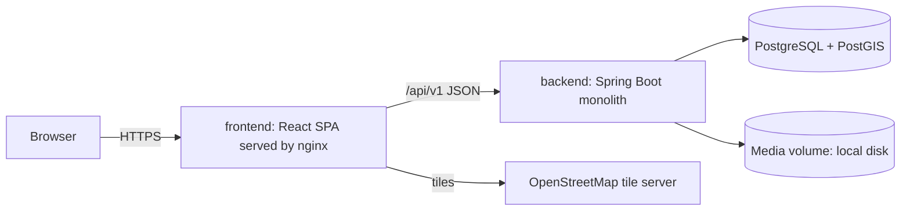
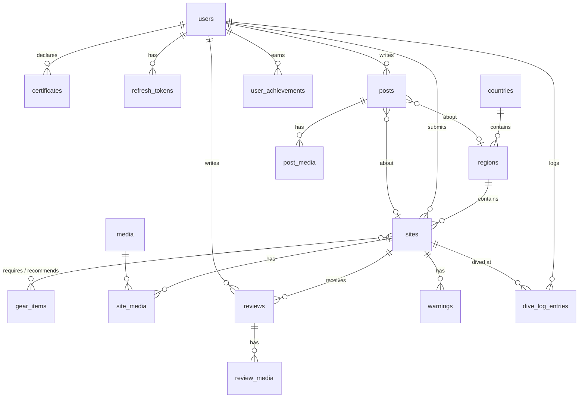

# DiveNet — Architecture

These are the rules every change follows. An OpenSpec change's `design.md`
covers only decisions local to that change. Any change that breaks a rule here
first adds an ADR in [adr/](adr/) and updates this file in the same PR.

Parts of this document marked **(planned)** describe code that does not exist yet.
Each one is built by the milestone named in [ROADMAP.md](ROADMAP.md).

## System context



| Container | Tech | Notes |
| --- | --- | --- |
| `frontend/` | React 19, Vite, TypeScript, pnpm | SPA. In production, nginx serves the static build and proxies `/api` and `/media` to the backend. |
| `backend/` | Java 25, Spring Boot 4.1, Maven (wrapper) | A single deployable REST API built as a modular monolith. |
| `db` | PostgreSQL 17 + PostGIS 3 (`postgis/postgis` image) | The only datastore. There is no separate cache or search engine. |
| media | A local directory, mounted as a Docker volume | Accessed only through the `MediaStorage` interface (ADR-0006). |

`compose.yaml` at the repository root runs the full stack **(planned, M0)**.

## Repository layout (planned, M0)

```
backend/                 Maven project (mvnw), Spring Boot app
  src/main/java/ua/ukma/divenet/<module>/
  src/main/resources/db/migration/   Flyway migrations
  src/main/resources/seed/           demo seed data (JSON)
frontend/                Vite app, pnpm workspace member
  src/features/<feature>/            feature folders mirroring backend modules
  src/i18n/locales/{en,uk}.json
  e2e/                               Playwright tests
api/openapi.json         committed OpenAPI snapshot (shared contract)
compose.yaml             db + backend + frontend
scripts/check.mjs        the single quality gate
openspec/                OpenSpec specs and changes
docs/                    product, architecture, roadmap, ADRs, handoff
```

## Back-end

### Modules

The base package is `ua.ukma.divenet`. Each top-level package below is a module,
and Spring Modulith verifies the module boundaries in a test (ADR-0002).

| Module | Owns | Stories |
| --- | --- | --- |
| `shared` | Error handling, pagination, security configuration, clock, base test support | — |
| `auth` | Registration, login, JWT issuing, refresh tokens | M0 |
| `user` | Profile, avatar, privacy settings, certificates | US-11, US-C1 |
| `geo` | Countries, regions (reference data) | US-05, US-15 |
| `site` | Dive sites, gear catalog, search and filters, map markers, submission and moderation | US-01, 02, 05–08 |
| `review` | Reviews, ratings, rating aggregates | US-03, US-04 |
| `warning` | Site warnings | US-S1 |
| `divelog` | Dive log entries | US-09 |
| `achievement` | Achievement rules, progress, awards | US-10 |
| `post` | Posts, drafts, global, region and site feeds | US-12, 13, 15, 16 |
| `media` | Upload, storage, thumbnails, serving | US-04, US-11, US-12 |

Rules:

- Inside a module, organise code by layer: `web` (controllers and request/response DTOs),
  `service`, `domain` (entities and repositories). Only the module's public
  service interfaces and its events may be used from other modules.
- Modules never use each other's repositories or entities. To refer to another
  module's aggregate, store its ID (for example, a review stores `siteId`).
- Side effects across modules go through Spring application events. For
  example, `DiveLogged`, `PostPublished` and `SiteApproved` are consumed by
  `achievement`. Use `@TransactionalEventListener` or Modulith's
  `@ApplicationModuleListener`.
- Controllers stay thin and services hold the transactions. Entities are never
  serialised directly.

### Persistence and PostGIS (ADR-0003)

- Hibernate 7 (JPA) with `hibernate-spatial`. Locations are `geography(Point,4326)`
  columns mapped to `org.locationtech.jts.geom.Point`, with a GiST index on each.
- Flyway owns the schema: `ddl-auto=validate` everywhere and never
  `update`/`create`. Migrations live in `backend/src/main/resources/db/migration/V<n>__<snake_case>.sql`.
  Never edit a migration that has been merged; add a new one instead.
- Reference data (countries, regions, gear, achievement definitions) goes into migrations.
  Demo content (sites, users, posts, media) is loaded by a seeder that runs
  only under the `demo` profile.
- Viewport and radius queries use native SQL (`ST_MakeEnvelope`, `ST_DWithin`)
  where HQL spatial functions are awkward.
- Name search uses `ILIKE` backed by a `pg_trgm` GIN index. There is no external search engine.
- The API never exposes JTS types. DTOs carry `lat` and `lng` as plain numbers.

### Data model overview (planned)



Each change that adds tables updates this diagram.

### API conventions

- REST over JSON under `/api/v1`. Resource names are plural nouns, for example
  `/api/v1/sites/{id}/reviews`.
- Errors use RFC 9457 `ProblemDetail` (`application/problem+json`). Validation
  errors list field errors in an `errors` property. Status codes: 400 validation,
  401 unauthenticated, 403 forbidden, 404 not found, 409 conflict.
- Pagination uses `?page=0&size=20` (max 100). The response is
  `{ content, page: { number, size, totalElements, totalPages } }`, from Spring
  Data's `PagedModel`.
- Map markers come from `GET /api/v1/sites/markers` with the same filter parameters
  as the site search. It returns all matching approved sites as a lightweight
  list, without pagination; clustering happens on the client.
- Dates and times are ISO-8601 in UTC (`Instant`). Dive dates are `LocalDate`.
- **Shared contract:** the OpenAPI document generated by springdoc is committed
  to `api/openapi.json`. Front-end API types are generated from it (`openapi-typescript`).
  The quality gate fails if either the snapshot or the generated types are stale.
  Any change to the contract updates the snapshot, the types and every affected
  front-end feature in the same PR.

### Security (ADR-0004)

- Email + password registration. Passwords are hashed with Spring Security's
  `DelegatingPasswordEncoder` (bcrypt).
- Stateless JWT access tokens (15 min) are sent as `Authorization: Bearer`. A
  rotating refresh token (14 days) is stored hashed in the database and sent in an
  `HttpOnly`, `SameSite=Strict` cookie scoped to `/api/v1/auth`.
- The roles are `USER` and `ADMIN`. Authorisation uses method security (`@PreAuthorize`) plus
  explicit ownership checks in services: only the author edits or deletes their own content.
- GET requests for public content are anonymous. Admin endpoints live under `/api/v1/admin/**`.
- Secrets (JWT key, DB password) come from environment variables. Only
  `.env.example` is committed.

### Media (ADR-0006)

- `POST /api/v1/media` (multipart) accepts JPEG, PNG and WebP up to 10 MB. The
  type is checked by content, not by file extension.
- Files are stored through `MediaStorage` (local-disk implementation), and the
  database keeps the metadata. A resized thumbnail is generated on upload.
- Files are served from `GET /media/{id}` and `/media/{id}/thumb`. Unreferenced
  uploads older than 24 h are deleted by a scheduled job.

## Front-end (ADR-0005)

- React Router for routing and TanStack Query for server state. There is no
  global client store unless a change justifies one.
- Forms use React Hook Form with Zod schemas.
- Map: Leaflet through `react-leaflet` plus marker clustering, with OpenStreetMap
  tiles and attribution.
- Code lives in feature folders under `src/features/`, mirroring the back-end
  modules. Shared UI goes in `src/components/`, and the API client and generated
  types in `src/api/`.
- **i18n:** `react-i18next` with the locales `en` (default and fallback) and `uk`.
  User-visible strings are never hard-coded. Every key exists in both locale
  files, and the gate checks this. Dates and numbers are formatted with `Intl`
  for the active locale. User content is not translated.
- Styling and visual design follow `docs/DESIGN.md` once it exists (planned:
  produced with Claude Design). Until then, use plain CSS modules and keep the
  styling minimal.
- Every site page and the page footer show the safety disclaimer.

## Testing strategy

| Level | Back-end | Front-end |
| --- | --- | --- |
| Unit | JUnit 5 + AssertJ (services, rules, mappers) | Vitest + Testing Library (components, hooks) |
| Integration / functional | `@SpringBootTest` + Testcontainers (`postgis/postgis`), MockMvc against real endpoints | Vitest with MSW-mocked API |
| Architecture | Spring Modulith `ApplicationModules.verify()` | — |
| E2E | — | Playwright against the `compose.yaml` stack with demo seed |

- Every OpenSpec requirement scenario is covered by at least one automated test,
  and the test name or a comment cites the requirement.
- Integration tests need Docker, so the gate needs Docker for the back-end.
- E2E covers the main journeys only: browse the map → site page; register →
  review; log a dive → achievement; write a post → feed. It runs in CI after the
  gate, not inside it.

## Code style

- Back-end: Spotless with `palantir-java-format`, checked during `mvn verify`.
  Use records for DTOs; no Lombok.
- Front-end: TypeScript `strict`, ESLint, Prettier in check mode.
- Code, comments, commit messages and docs are in English. Only the `uk`
  locale file contains Ukrainian.
