::: {custom-style="Report Title"}
DiveNet: соціальна платформа для спільноти дайверів
:::

::: {custom-style="Report Subtitle"}
Підсумковий звіт з дисципліни «Проектування програмних систем»
:::

::: {custom-style="Report Subtitle"}
Практична робота № 7
:::

```{=openxml}
<w:p><w:pPr><w:pStyle w:val="TOCHeading"/></w:pPr><w:r><w:t>Зміст</w:t></w:r></w:p>
<w:p><w:r><w:fldChar w:fldCharType="begin" w:dirty="true"/></w:r><w:r><w:instrText xml:space="preserve"> TOC \o "1-2" \h \z \u </w:instrText></w:r><w:r><w:fldChar w:fldCharType="separate"/></w:r><w:r><w:t>Щоб побудувати зміст, оновіть поле (F9).</w:t></w:r><w:r><w:fldChar w:fldCharType="end"/></w:r></w:p>
```

# Вступ

DiveNet – соціальна вебплатформа для дайверів. На мапі світу користувач знаходить дайв-сайти, відбирає їх за складністю, глибиною, спорядженням, регіоном і оцінкою, читає відгуки та попередження інших дайверів. Зареєстрований дайвер веде журнал занурень, отримує досягнення, додає свої сертифікати, пише відгуки й дописи та пропонує нові сайти, які затверджує адміністратор. Інтерфейс доступний англійською та українською мовами.

У звіті зведено результати практичних робіт курсу: планування проєкту, функціональні, нефункціональні та системні вимоги, план у сервісі Wrike і проєктні UML-діаграми. Вимоги та опис системи наведено для завершеної версії продукту.

# 1. Планування проєкту

## 1.1. Загальні відомості

**Назва проєкту.** DiveNet: соціальна платформа для спільноти дайверів.

**Предметна область.** Інформаційні технології у сфері підводного спорту й туризму: каталог і картографування дайв-сайтів, обмін досвідом між дайверами, безпека занурень.

**Тип проєкту.** Вебзастосунок, клієнтська частина якого працює в браузері як односторінковий застосунок (SPA), а серверна надає REST API. Початково серверну частину планувалося побудувати з мікросервісів, проте на етапі проєктування було обрано шаровий моноліт. Система має одне розгортання й одну базу даних, тож мікросервіси лише ускладнили б взаємодію компонентів і тестування. Модулі моноліту відокремлені один від одного (підрозділ 3.1).

**Тривалість проєкту.** 07.09.2026–23.11.2026.

## 1.2. Мета проєкту

Створити соціальну платформу для дайверів, на якій можна знайти дайв-сайт на мапі за низкою критеріїв, оцінити його за описом, відгуками та попередженнями інших дайверів, вести журнал власних занурень і ділитися досвідом у дописах, пов'язаних із сайтами та регіонами.

## 1.3. Актуальність

За даними асоціації DEMA, у світі налічується 5–6 мільйонів активних сертифікованих дайверів [1]. Асоціація PADI за 1970–2020 роки видала 28 мільйонів сертифікатів [2]. Дослідження Fortune Business Insights прогнозує щорічне зростання ринку дайвінг-туризму на 11,68 % [3]. Отже, попит на програмне забезпечення для дайверів існує і зростає.

Наявні системи здебільшого закривають лише одну потребу:

- електронні журнали занурень (Subsurface, Garmin Dive) зосереджені на особистій телеметрії й майже не мають соціальної взаємодії;
- каталоги сайтів містять статичні дані (глибина, тип дна) без досвіду реальних дайверів;
- спілкування спільноти розпорошене між групами в месенджерах і форумами.

DiveNet поєднує каталог сайтів, відгуки й попередження від дайверів, особистий журнал занурень і стрічку дописів.

## 1.4. Завдання проєкту

1. Проаналізувати потреби зацікавлених сторін: дайверів-початківців, досвідчених дайверів, інструкторів і дайв-центрів, адміністраторів платформи.
2. Визначити функціональні, нефункціональні та системні вимоги.
3. Спроєктувати систему: схему бази даних, архітектуру, UML-діаграми, дизайн інтерфейсу.
4. Розробити REST API для облікових записів, профілів, дайв-сайтів, відгуків, попереджень, журналу занурень, досягнень, дописів і медіафайлів.
5. Розробити клієнтський застосунок з інтерактивною мапою, пошуком і фільтрами, сторінками сайтів, профілями та стрічками.
6. Покрити систему автоматизованими тестами: модульними, інтеграційними та наскрізними (E2E).
7. Забезпечити розгортання системи однією командою разом із демонстраційними даними.

## 1.5. Зміст проєкту

Система складається з таких підсистем:

- **Облікові записи та профілі:** реєстрація та вхід, публічний профіль з аватаром і біографією, налаштування приватності, сертифікати (PADI, SSI, CMAS та інші), які перевіряє адміністратор, шафка особистого спорядження (Gear Locker).
- **Каталог дайв-сайтів і мапа:** мапа світу з кластеризацією маркерів, сторінка сайту, пошук і фільтри, подання нових сайтів та їх модерація.
- **Відгуки та оцінки:** оцінка сайту від 1 до 5, оцінка складності, текст, фото й відео; з відгуків обчислюються середня оцінка та складність за оцінками спільноти.
- **Безпека занурень:** попередження про небезпеки, інциденти або змінені умови на сайті; застереження про довідковий характер даних платформи.
- **Журнал занурень і досягнення:** записи про занурення з параметрами (максимальна глибина, видимість, температура води, течія, напарники, нотатки), статистика дайвера, досягнення, які нараховуються автоматично.
- **Дописи та стрічки:** дописи з обкладинкою, фото й відео, чернетки, прив'язка до регіону та сайту, загальна стрічка, стрічка регіону, дописи на сторінці сайту.
- **Медіафайли:** завантаження зображень і відео, створення ескізів, зберігання в об'єктному сховищі MinIO.
- **Локалізація:** інтерфейс англійською та українською мовами.

Порівняно з початковим планом зміст проєкту дещо змінився. Окремі «звіти про занурення» не виділялися: параметри занурення записуються в журнал, а фото й опис публікуються у відгуку чи дописі. Модуль офлайн-синхронізації та побудову маршрутів вилучено з обсягу робіт, а нові попередження з'являються на сторінці сайту після її оновлення, без сповіщень у реальному часі. Натомість додано шафку спорядження, відео у відгуках і дописах та об'єктне сховище для медіафайлів.

## 1.6. Графік робіт

| Етап | Період | Зміст |
|----|----|----|
| Підготовчий | 07.09–21.09 | Тема, мета, аналіз предметної області, конкурентів і потреб користувачів |
| Планування | 07.09–05.10 | План і графік, вимоги до системи, схема бази даних |
| Розробка | 05.10–16.11 | Дизайн інтерфейсу, ітеративна розробка функцій |
| Тестування | 16.11–23.11 | Наскрізне тестування, перевірки продуктивності, безпеки й доступності |
| Запуск | 20.11–23.11 | Документація, звіт, розгортання та демонстрація |

Початковий графік передбачав, що спершу буде розроблено серверну частину, а потім клієнтську. Фактично розробка велася ітераціями: кожна ітерація завершувалася робочою функцією з міграціями бази даних, API, інтерфейсом і тестами, тому функції можна було перевіряти одразу після реалізації. Модульні та інтеграційні тести писалися разом із кодом. Ітерації виконувалися в такому порядку:

1. Основа: каркас серверної та клієнтської частин, автоматичні перевірки, контейнери, автентифікація, оболонка інтерфейсу.
2. Сайти та мапа: довідники країн, регіонів і спорядження, каталог сайтів, пошук і фільтри, подання та модерація.
3. Відгуки, медіафайли та попередження.
4. Профіль дайвера, журнал занурень, сертифікати.
5. Дописи та стрічки.
6. Досягнення.
7. Підготовка до випуску: доопрацювання дизайну сторінок, демонстраційні дані, наскрізні тести, перевірки продуктивності, безпеки й доступності.

Шафку спорядження, відео та сховище MinIO реалізовано після основних ітерацій.

## 1.7. Ризики проєкту

| Ризик | Опис | Заходи |
|----|----|----|
| Безпековий і юридичний | Відповідальність за неточні дані про небезпеку сайту | Застереження на сторінці кожного сайту та внизу кожної сторінки: дані мають довідковий характер і не замінюють планування занурення |
| Продуктовий | «Порожня база»: без даних платформа не корисна новим користувачам | Демонстраційні дані: 51 реальний дайв-сайт, 8 дайверів з відгуками, зануреннями та дописами |
| Якість даних | Користувачі можуть додати неіснуючий сайт або вигаданий сертифікат | Модерація нових сайтів і перевірка сертифікатів адміністратором |

## 1.8. Напрями діяльності

- **Аналітичний:** дослідження предметної області та потреб зацікавлених сторін, вимоги до системи.
- **Дизайн інтерфейсу:** дизайн-система у світлій і темній темах, макети сторінок.
- **Front-end розробка:** клієнтський застосунок.
- **Back-end розробка:** REST API, бізнес-логіка, база даних, геопошук, обробка медіафайлів.
- **Тестування та QA:** автоматизовані тести всіх рівнів.
- **Розгортання та документування:** контейнери, безперервна інтеграція (CI), документація та звіти.

## 1.9. Результати проєкту

Робочий вебзастосунок, що відповідає вимогам розділів 2 і 3, запускається однією командою разом із демонстраційними даними та перевіряється автоматизованими тестами в CI.

## 1.10. Склад виконавців

- **Золотарьов Олександр:** back-end розробка, QA.
- **Кулакевич Стас:** Scrum Master, back-end розробка.
- **Кондрашов Тимофій:** front-end розробка, UI/UX.
- **Степаненко Назар:** створення та підтримка бази даних, back-end розробка на Java.
- **Ткаченко Олександр:** back-end і front-end розробка.

Зовнішні організації до проєкту не залучалися.

# 2. Вимоги до системи

## 2.1. Користувачі системи

| Роль | Потреби |
|----|----|
| Гість | Переглядати мапу, сторінки сайтів, відгуки, попередження, дописи та публічні профілі без реєстрації |
| Дайвер-початківець | Знаходити сайти, що відповідають його рівню; читати досвід і попередження інших |
| Досвідчений дайвер | Вести журнал занурень з параметрами; ділитися детальними звітами; додавати нові сайти |
| Інструктор або дайв-центр | Публікувати дописи про сайти й регіони, де він працює. Використовує звичайний обліковий запис дайвера: окремих бізнес-акаунтів немає |
| Адміністратор | Модерувати подані сайти, перевіряти сертифікати, приховувати неприйнятні попередження |

Гість може читати весь публічний контент. Зареєстровані користувачі мають роль `USER` або `ADMIN`.

## 2.2. Користувацькі історії

**US-01. Перегляд мапи.** Як дайвер, я хочу переглядати мапу світу з позначеними дайв-сайтами, щоб знаходити цікаві місця для занурень.

**US-02. Сторінка дайв-сайту.** Як дайвер, я хочу бачити детальну інформацію про сайт, щоб оцінити, чи підходить він мені.

**US-03. Перегляд відгуків.** Як дайвер, я хочу читати відгуки інших дайверів про сайт, щоб дізнатися про їхній досвід.

**US-04. Оцінювання та відгук.** Як дайвер, я хочу оцінити сайт і написати відгук, щоб допомогти іншим.

**US-05. Фільтрація сайтів.** Як дайвер, я хочу фільтрувати сайти за кількома критеріями одночасно, щоб швидко знаходити придатні місця.

**US-06. Пошук сайтів.** Як дайвер, я хочу шукати сайти за назвою або місцезнаходженням, щоб швидко знайти потрібне місце.

**US-07. Подання сайту.** Як дайвер, я хочу додати на мапу новий сайт, щоб поділитися ним з іншими.

**US-08. Модерація сайтів.** Як адміністратор, я хочу перевіряти подані сайти, щоб інформація на платформі була достовірною.

**US-09. Журнал занурень.** Як дайвер, я хочу записувати свої занурення, щоб вести їхню історію.

**US-10. Досягнення.** Як дайвер, я хочу отримувати досягнення за активність, щоб відстежувати свій прогрес.

**US-11. Профіль дайвера.** Як дайвер, я хочу мати публічний профіль із зануреннями та досягненнями, щоб показати свій досвід іншим.

**US-12. Блог.** Як дайвер, я хочу писати дописи про свої занурення, щоб ділитися досвідом і враженнями.

**US-13. Загальна стрічка.** Як дайвер, я хочу бачити стрічку нових дописів від усіх користувачів, щоб знаходити цікавий досвід.

**US-14. Стрічка регіону.** Як дайвер, я хочу бачити дописи про обрану країну чи регіон, щоб дізнатися про досвід занурень там.

**US-15. Дописи про сайт.** Як дайвер, я хочу бачити дописи про конкретний сайт, щоб отримати свіжу інформацію про нього.

**US-16. Попередження.** Як дайвер, я хочу бачити й публікувати попередження про сайт (небезпеки, інциденти, змінені умови), щоб інші занурювалися безпечно.

**US-17. Сертифікати.** Як дайвер, я хочу заявити свої сертифікати, щоб інші бачили мій рівень підготовки.

**US-18. Шафка спорядження.** Як дайвер, я хочу вести список свого спорядження в профілі, щоб інші бачили, з чим я занурююся.

**US-19. Обліковий запис.** Як відвідувач, я хочу зареєструватися та входити в систему, щоб робити внесок у спільноту.

**US-20. Мова інтерфейсу.** Як користувач, я хочу перемикати інтерфейс між англійською та українською, щоб користуватися платформою зрозумілою мені мовою.

## 2.3. Функціональні вимоги

### US-01. Перегляд мапи

1. Головна сторінка показує інтерактивну мапу світу (тайли OpenStreetMap) з маркерами всіх затверджених сайтів.
2. Мапу можна переміщувати й масштабувати. Близькі маркери об'єднуються в кластери з кількістю сайтів.
3. Вибір маркера відкриває коротку картку сайту (назва, складність словом, оцінка) з посиланням на сторінку сайту.
4. Якщо дані не завантажилися, сторінка повідомляє про помилку.

### US-02. Сторінка дайв-сайту

1. Сторінка показує назву, координати, країну та регіон, опис, заявлену складність від 1 до 5 і складність за оцінками спільноти, діапазон глибин, обов'язкове та рекомендоване спорядження, середню оцінку та кількість оцінок.
2. На сторінці показано відгуки, останні попередження, дописи про сайт і застереження про безпеку.
3. Зі сторінки можна написати або відредагувати свій відгук, записати занурення на цьому сайті та повернутися до мапи.
4. Для неіснуючого сайту показано повідомлення «не знайдено». Незатверджений сайт бачать тільки автор і адміністратор, разом зі статусом модерації.

### US-03. Перегляд відгуків

1. Відгуки сайту виводяться частинами (посторінково) й сортуються за новизною або за оцінкою.
2. Відгук показує автора з посиланням на профіль, аватаром і позначкою підтвердженого сертифіката, дату, оцінку, оцінку складності, текст, фото та відео.

### US-04. Оцінювання та відгук

1. Авторизований користувач залишає відгук на затверджений сайт: оцінку від 1 до 5, текст до 4000 символів або обидва, оцінку складності від 1 до 5, до 6 фото та до 3 відео.
2. Користувач може мати лише один відгук на сайт. Повторний відгук відхиляється, а сторінка сайту пропонує відредагувати наявний.
3. Автор редагує та видаляє свій відгук; видалення потребує підтвердження.
4. Середня оцінка, кількість оцінок і складність за оцінками спільноти перераховуються в тій самій транзакції, що й створення, зміна чи видалення відгуку.

### US-05. Фільтрація сайтів

1. Сайти фільтруються за складністю, обов'язковим спорядженням, країною, регіоном, діапазоном глибин і мінімальною оцінкою.
2. Фільтри поєднуються між собою та з текстовим пошуком.
3. Мапа та список результатів показують лише відповідні сайти; список сортується за назвою або оцінкою.
4. Критерії пошуку зберігаються в адресі сторінки, тому посиланням на результат можна поділитися.
5. На вузьких екранах фільтри відкриваються кнопкою, а результати показано у висувній панелі.

### US-06. Пошук сайтів

1. Пошук знаходить сайти за назвою сайту, регіону або країни. Назви регіонів і країн шукаються мовою інтерфейсу.
2. Кожен результат веде на сторінку сайту, а якщо нічого не знайдено, показано відповідне повідомлення.

### US-07. Подання сайту

1. Авторизований користувач подає сайт: назву, опис, координати, регіон, заявлену складність, діапазон глибин, обов'язкове та рекомендоване спорядження.
2. Дані перевіряються: назва до 120 символів, опис до 5000 символів, широта від −90° до 90°, довгота від −180° до 180°, складність від 1 до 5, глибина від 0 до 400 м, мінімальна глибина не більша за максимальну, один предмет спорядження не може бути одночасно обов'язковим і рекомендованим.
3. Поданий сайт отримує статус «на розгляді» та не видний іншим користувачам до затвердження.
4. Автор бачить свої заявки з їхнім статусом і причиною відхилення.

### US-08. Модерація сайтів

1. Адміністратор бачить чергу поданих сайтів і затверджує сайт або відхиляє його із зазначенням причини (від 1 до 500 символів).
2. Модерувати можна лише сайт у статусі «на розгляді»; рішення остаточне.
3. Затверджений сайт з'являється на мапі для всіх.

### US-09. Журнал занурень

1. Авторизований дайвер записує занурення: сайт (вибраний із каталогу або зі сторінки сайту), дату та необов'язкові параметри: максимальну глибину (0–400 м), видимість (0–200 м), температуру води (від −5 до 40 °C), течію (немає, слабка, помірна, сильна), напарників і нотатки.
2. Дата занурення не може бути в майбутньому.
3. Автор редагує та видаляє свої записи.
4. Профіль показує статистику дайвера: кількість занурень, кількість відвіданих сайтів і найбільшу глибину, а також історію занурень і відвідані сайти.
5. Напарників і нотатки бачить лише власник журналу, бо там можуть бути імена інших людей.

### US-10. Досягнення

1. Система має вісім досягнень: перше занурення, 10 занурень, 10 відвіданих сайтів, занурення в 5 країнах, занурення на глибину від 40 м, перший опублікований допис, 5 опублікованих дописів, перший затверджений сайт.
2. Умови перевіряються після запису занурення, публікації допису та затвердження сайту, і досягнення нараховується одразу. Нараховане досягнення залишається назавжди та нараховується один раз.
3. Помилка під час нарахування не скасовує дію користувача.
4. Профіль показує отримані досягнення з датою та ще не отримані з прогресом до кожного. Сторінка журналу повідомляє про щойно отримане досягнення.

### US-11. Профіль дайвера

1. Публічний профіль показує ім'я, аватар, біографію, статистику, історію занурень і відвідані сайти, сертифікати, досягнення, дописи автора та шафку спорядження.
2. Будь-хто, зокрема гість, може переглянути профіль.
3. Власник редагує біографію та аватар і вирішує, чи показувати іншим журнал занурень, статистику та сертифікати.
4. Налаштування приватності перевіряє сервер: прихований розділ не повертається нікому, крім власника (для сертифікатів також адміністратору), а не лише ховається в інтерфейсі.

### US-12. Блог

1. Авторизований користувач створює, редагує та видаляє дописи: заголовок до 200 символів, текст до 20 000 символів, обкладинка, до 10 зображень і до 3 відео.
2. Допис можна прив'язати до регіону та/або дайв-сайту.
3. Допис зберігається як чернетка або публікується; для публікації потрібен текст. Чернетку бачить лише автор.
4. Опубліковані дописи автора показано в його профілі, а свої чернетки автор бачить окремим списком.
5. Видалення допису потребує підтвердження.

### US-13. Загальна стрічка

1. Стрічка показує опубліковані дописи всіх користувачів від найновіших, частинами (посторінково).
2. Зі стрічки авторизований користувач переходить до написання допису та до своїх чернеток.

### US-14. Стрічка регіону

1. Стрічку можна відфільтрувати за країною або регіоном.

### US-15. Дописи про сайт

1. Сторінка сайту показує дописи, прив'язані до цього сайту; зі сторінки можна перейти до стрічки дописів лише про цей сайт.

### US-16. Попередження

1. Авторизований користувач публікує попередження до затвердженого сайту: тип (небезпека, інцидент, змінені умови) і текст.
2. Сторінка сайту спочатку показує два найновіші попередження, решту можна розгорнути. Колір попередження залежить від типу, а час публікації протягом місяця показано відносно («3 дні тому»).
3. Автор редагує та видаляє своє попередження.
4. Адміністратор приховує попередження; приховане попередження зникає для всіх, зокрема для автора.

### US-17. Сертифікати

1. Авторизований користувач заявляє сертифікат: агентство (PADI, SSI, CMAS або інше), рівень, номер і, за бажанням, фото.
2. Новий сертифікат має статус «на розгляді». Адміністратор у черзі перевірки підтверджує його або відхиляє з причиною. Будь-яка зміна сертифіката повертає його на перевірку.
3. Підтверджений сертифікат дає позначку в профілі та біля імені автора відгуку.
4. Номер, фото, причину відхилення та відхилені сертифікати бачать лише власник і адміністратор.

### US-18. Шафка спорядження

1. Власник додає предмет спорядження (назва від 1 до 100 символів, до 100 предметів) і видаляє його.
2. Шафку спорядження показано в публічному профілі.

### US-19. Обліковий запис

1. Відвідувач реєструється за email, ім'ям (до 50 символів) і паролем (від 8 символів).
2. Користувач входить за email і паролем, а сесія автоматично продовжується, доки користувач активний, і завершується після виходу.
3. Повідомлення про помилку входу однакове для неіснуючого email і неправильного пароля.
4. Перший адміністратор створюється під час запуску з параметрів конфігурації.

### US-20. Мова інтерфейсу

1. Інтерфейс доступний англійською та українською мовами; перемикач мови є в заголовку сторінки.
2. Початкова мова відповідає збереженому вибору користувача або мові браузера; вибір зберігається.
3. Назви країн, регіонів, спорядження та досягнень перекладено; контент користувачів не перекладається. Дати й числа форматуються за правилами обраної мови.

## 2.4. Нефункціональні вимоги

### Продуктивність

1. Головна сторінка починає відображатися (First Contentful Paint) не пізніше ніж за 3 с, найбільший елемент сторінки (Largest Contentful Paint) з'являється не пізніше ніж за 5 с, а обсяг завантажених даних не перевищує 1,5 МБ. Показники вимірюються інструментом Lighthouse.
2. За навантаження 20 одночасних користувачів 95 % відповідей на пошук сайтів, сторінку сайту та стрічку надходять швидше ніж за 1,2 с, а на вхід у систему швидше ніж за 2 с; частка помилок менша за 1 %. Навантаження відтворюється сценаріями k6.
3. Списки відгуків, дописів і черги модерації передаються сторінками по 20 записів, не більше 100 записів за запит.

### Зручність використання

4. Система повідомляє про успішне виконання дій, помилки введення (із зазначенням поля), відсутність результатів пошуку та помилки завантаження даних.
5. Перед видаленням відгуку, попередження, допису, запису журналу чи сертифіката система запитує підтвердження.
6. Усі сторінки оформлено за єдиною дизайн-системою у світлій і темній темах; тема відповідає налаштуванням операційної системи.

### Адаптивність і сумісність

7. Інтерфейс адаптується до ширини екрана. На екранах, вужчих за 768 пікселів, макет стає одноколонковим, навігація переходить у бічне меню, а висота кнопок становить щонайменше 44 пікселі.
8. Застосунок працює в сучасних версіях браузерів Google Chrome, Mozilla Firefox і Safari, зокрема на мобільних пристроях.
9. Недоступність картографічного сервісу не порушує роботу решти платформи.

### Безпека

10. Паролі зберігаються лише як хеші bcrypt.
11. Токен доступу JWT діє 15 хвилин. Токен оновлення сесії діє 14 днів, передається в cookie з атрибутами `HttpOnly` і `SameSite=Strict`, замінюється під час кожного оновлення та зберігається в базі лише як хеш. Повторне використання вже заміненого токена відкликає всі токени сесії.
12. Зміна даних потребує автентифікації. Редагувати й видаляти контент може лише його автор, модерацію виконує лише адміністратор.
13. Налаштування приватності перевіряються на сервері під час кожного запиту. Незатверджений сайт і чернетка допису для сторонніх користувачів не існують: сервер відповідає кодом 404.
14. Тип завантаженого файлу визначається за вмістом. Приймаються зображення JPEG, PNG і WebP розміром до 10 МБ та відео MP4 і WebM розміром до 50 МБ.
15. Вебсервер встановлює заголовки безпеки: Content Security Policy, HSTS, `X-Content-Type-Options`, `X-Frame-Options` і `Referrer-Policy`.
16. Ключ підпису JWT і паролі передаються лише через змінні середовища; ключ JWT, коротший за 32 байти, не приймається.
17. Залежності перевіряються на відомі вразливості, а образи контейнерів сканує Trivy.

### Надійність

18. Кожна зміна даних виконується в одній транзакції з усіма пов'язаними змінами, тому невдала операція не залишає часткових даних.
19. Дані бази та медіафайли зберігаються в іменованих томах Docker і не втрачаються після перезапуску контейнерів.
20. Кожен контейнер має перевірку працездатності (health check), а сервіси запускаються лише після готовності тих, від яких залежать.
21. Повторне надсилання форми відгуку не створює дубліката: користувач має не більше одного відгуку на сайт.

### Доступність інтерфейсу

22. Інтерфейс відповідає критеріям WCAG 2.1 рівнів A та AA. Кожна сторінка перевіряється бібліотекою axe-core у наскрізних тестах, в обох темах і українською мовою.
23. Інтерфейсом можна користуватися з клавіатури; на кожній сторінці є посилання для переходу до основного вмісту.
24. Список результатів пошуку дублює вміст мапи для користувачів, яким мапа недоступна.

### Супроводжуваність

25. Код серверної частини поділено на модулі за предметними областями, а кожен модуль – на шари `web → service → domain`. Напрямок залежностей між шарами перевіряє архітектурний тест ArchUnit.
26. Контракт API описано документом OpenAPI, з якого генеруються типи клієнтської частини; розбіжність між API, документом і типами зупиняє збирання.
27. Схема бази даних змінюється лише міграціями Flyway, а налаштування середовищ задаються змінними середовища без змін коду.

### Цілісність даних і конфіденційність

28. Середня оцінка сайту та його складність за оцінками спільноти завжди відповідають відгукам; незатверджений сайт не потрапляє ні на мапу, ні в результати пошуку.
29. Координати сайту перевіряються перед збереженням (широта від −90° до 90°, довгота від −180° до 180°), час зберігається в UTC.
30. Користувач визначає, чи бачать інші його журнал занурень, статистику та сертифікати. Номер і фото сертифіката, напарники й нотатки в журналі доступні лише власнику (сертифікати також адміністратору).

# 3. Системні вимоги

## 3.1. Архітектура

1. Система має клієнт-серверну архітектуру з такими компонентами: клієнтський застосунок у браузері, вебсервер nginx, серверний застосунок, база даних PostgreSQL з PostGIS і сховище медіафайлів MinIO.
2. Клієнт і сервер обмінюються даними через REST API у форматі JSON за адресою `/api/v1`. Вебсервер віддає зібраний клієнтський застосунок і передає запити `/api` та `/media` серверному застосунку.
3. Серверний застосунок є шаровим монолітом. Код поділено на модулі за предметними областями (`auth`, `user`, `geo`, `site`, `review`, `warning`, `divelog`, `achievement`, `post`, `media`), спільну інфраструктуру винесено в модуль `shared`. Кожен модуль має шари `web` (контролери та DTO), `service` (бізнес-правила й транзакції) і `domain` (сутності та репозиторії).
4. Сутності бази даних не передаються через API: сервіси повертають власні об'єкти даних, які контролери перетворюють на відповіді.
5. Дії, що впливають на інші модулі, публікуються як події застосунку. Так, події `DiveLogged`, `PostPublished` і `SiteApproved` після завершення транзакції запускають нарахування досягнень.

## 3.2. Серверна частина

1. Мова Java 25, фреймворк Spring Boot 4.1, збирання Maven.
2. REST API реалізовано засобами Spring Web MVC, вхідні дані перевіряються Bean Validation.
3. Доступ до даних: Spring Data JPA, Hibernate 7, Hibernate Spatial для геоданих.
4. Автентифікація: Spring Security як сервер ресурсів OAuth2 з токенами JWT. Ролі перевіряються анотаціями методів, право власності на контент перевіряють сервіси.
5. Помилки повертаються у форматі RFC 9457 (`application/problem+json`) з відповідними кодами HTTP; помилка валідації містить перелік хибних полів.
6. Документ OpenAPI генерує springdoc; його знімок зберігається в репозиторії як контракт між клієнтом і сервером.
7. Стан працездатності надає Spring Boot Actuator.
8. Для зображень під час завантаження створюються ескізи.
9. Тести: JUnit 5, AssertJ, Spring Boot Test, Testcontainers (PostgreSQL з PostGIS і MinIO у контейнерах), ArchUnit. Форматування коду перевіряє Spotless.

## 3.3. Клієнтська частина

1. Мова TypeScript, бібліотека React 19, збирання Vite, пакетний менеджер pnpm.
2. Маршрутизація React Router, кешування даних сервера TanStack Query, форми React Hook Form зі схемами валідації Zod.
3. Мапа: Leaflet (react-leaflet) з кластеризацією маркерів, тайли OpenStreetMap.
4. Локалізація: react-i18next з мовами `en` і `uk`; дати й числа форматуються засобами `Intl`.
5. Клієнт API використовує типи, згенеровані з документа OpenAPI.
6. Стилі: CSS-модулі, які використовують лише токени дизайн-системи; шрифти розміщено разом із застосунком.
7. Тести: Vitest і Testing Library; статичний аналіз ESLint, форматування Prettier.

## 3.4. База даних

1. СКБД PostgreSQL 17 з розширеннями PostGIS 3 і `pg_trgm`.
2. Координати сайтів зберігаються в стовпцях типу `geography(Point, 4326)` з індексом GiST; пошук за назвою прискорює триграмний індекс GIN.
3. Схему створюють і змінюють міграції Flyway (18 міграцій), Hibernate лише перевіряє відповідність сутностей схемі.
4. Довідкові дані (країни, регіони, спорядження, досягнення) додаються міграціями; кожен запис має текстовий код, за яким інтерфейс показує переклад назви.
5. Цілісність даних забезпечують первинні й зовнішні ключі, обмеження `CHECK` і `UNIQUE` та транзакції.
6. Демонстраційні дані завантажуються під час першого запуску з профілем `demo` через ті самі сервіси, що обробляють дії користувачів.

## 3.5. Зберігання медіафайлів

1. Файли зберігаються в приватному бакеті MinIO, а в базі даних – лише їхні метадані. Сервер звертається до сховища через інтерфейс `MediaStorage`, що має реалізації для MinIO та для локального диска.
2. Файли доступні за адресами `/media/{id}` і `/media/{id}/thumb`; відео передаються частинами (HTTP range requests), що дозволяє їх перемотувати.
3. Файли, не прикріплені до контенту протягом 24 годин, видаляються за розкладом.

## 3.6. Розгортання

1. Система розгортається засобами Docker Compose з файлу `compose.yaml`, що описує чотири сервіси: `db`, `minio`, `backend` і `web`.
2. Назовні відкрито лише порт сервісу `web`; база даних, сховище та серверний застосунок доступні тільки у внутрішній мережі Docker.
3. Кожен сервіс має перевірку працездатності, порядок запуску залежить від готовності сервісів.
4. Дані бази та сховища зберігаються в іменованих томах `db-data` і `minio-data`.
5. Конфігурація та секрети передаються через змінні середовища з файлу `.env`; у репозиторії зберігається лише шаблон `.env.example`.
6. Версії образів зафіксовано.
7. Серверну частину зібрано у виконуваний JAR, що запускається в контейнері з Java 25; клієнтську частину зібрано в статичні файли, які віддає nginx.
8. Система запускається командою `docker compose up --build` і доступна за адресою `http://localhost:8080`.

## 3.7. Апаратне та програмне середовище

1. Для розробки та запуску потрібні Docker і Docker Compose v2, JDK 25, Node.js 24, pnpm і Git. Розробка велася на Windows 11, CI виконується на Ubuntu.
2. Для роботи з платформою достатньо сучасного браузера.

## 3.8. Супровід і тестування

1. Код зберігається в репозиторії Git на GitHub. Гілка `master` захищена: зміни потрапляють до неї лише через pull request після успішної перевірки в CI.
2. Команда `pnpm check` запускає всі перевірки якості: форматування, статичний аналіз, перевірку типів, відповідність мовних файлів, конфігурацію контейнерів, модульні та інтеграційні тести, архітектурний тест і перевірку контракту API.
3. Для кожного pull request CI виконує перевірки якості, запуск і перезапуск повного стеку, наскрізні тести, тести продуктивності та сканування образів на вразливості.
4. Автоматизовані тести: 440 тестів серверної частини (з них 46 класів інтеграційних тестів зі справжньою базою даних), 383 тести клієнтської частини та 16 наскрізних тестів Playwright.
5. Наскрізні тести охоплюють сценарії: перегляд мапи та сайту гостем, реєстрацію та відгук із фото, запис занурення з отриманням досягнення, публікацію допису та його появу в стрічці, модерацію адміністратором, продовження сесії після завершення дії токена доступу.
6. Навантажувальні тести виявили, що проксі-сервер відкривав нове з'єднання із серверним застосунком для кожного запиту й під навантаженням вичерпував доступні порти. Після налаштування пулу з'єднань повторний прогін 70 000 запитів завершився без помилок.

# 4. План проєкту у Wrike

Мета цього етапу: скласти детальний план проєкту «DiveNet – соціальна платформа для спільноти дайверів» у хмарному сервісі Wrike, описати етапи проєкту, команду, завдання, строки, відповідальних і результати кожного завдання. План складено 26.10.2026, і рисунки показують його стан на цю дату.

## 4.1. Налаштування Wrike

У Wrike створено проєкт «DiveNet – соціальна платформа для спільноти дайверів» у просторі «First space». Проєкт містить п’ять папок-етапів і 17 завдань із датами початку й завершення, відповідальними та статусами. До простору додано всіх п’ятьох учасників команди.

Опис проєкту містить мету, стек технологій, архітектуру, ризики, склад команди та посилання на репозиторій. Кожна папка-етап має опис мети, періоду та результату етапу.

Опис кожного завдання складено за єдиним шаблоном:

- **Мета –** що потрібно досягти;
- **Обсяг робіт –** перелік підзадач;
- **Результат (артефакт) –** документ, звіт або pull request;
- **Критерії готовності –** умова, за якої завдання вважається виконаним;
- **Зв’язок з вимогами –** номери користувацьких історій US-xx, нефункціональних і системних вимог;
- **Залежності –** після якого завдання можна починати;
- **Відповідальний –** виконавець або виконавці.

Робочий процес завдань має статуси New → Planned → In progress → In review → Completed. Статуси відповідають фактичному стану роботи в репозиторії.

## 4.2. Етапи проєкту

- **Підготовчий етап –** тема, мета, аналіз предметної області, конкурентів і потреб стейкхолдерів (07.09–21.09).
- **Планування –** план і графік, функціональні, нефункціональні та системні вимоги, схема бази даних (07.09–05.10).
- **Розробка –** back-end (05.10–02.11), UI/UX-дизайн (26.10–02.11) і front-end (02.11–16.11).
- **Тестування –** unit-, інтеграційне, функціональне та E2E-тестування (16.11–23.11); автоматизовані тести пишуться разом із кодом від початку розробки.
- **Запуск –** документація, звіт, розгортання й демонстрація застосунку (20.11–23.11).

Перелік завдань у Wrike (стан на 26.10.2026):

| **№** | **Завдання** | **Строки (2026)** | **Відповідальний** | **Статус** |
|----|----|----|----|----|
| 1 | Визначити тему, мету та склад команди | 07.09–10.09 | Кулакевич С. | Completed |
| 2 | Аналіз предметної області та конкурентів | 10.09–15.09 | уся команда | Completed |
| 3 | Аналіз потреб стейкхолдерів | 14.09–21.09 | Золотарьов О. | Completed |
| 4 | Скласти план проєкту та графік робіт | 07.09–14.09 | Кулакевич С. | Completed |
| 5 | Визначити функціональні вимоги (користувацькі історії) | 21.09–25.09 | Ткаченко О. | Completed |
| 6 | Визначити нефункціональні вимоги | 24.09–28.09 | Золотарьов О. | Completed |
| 7 | Визначити системні вимоги (архітектура, стек, розгортання) | 28.09–05.10 | уся команда | Completed |
| 8 | Спроєктувати схеми баз даних | 28.09–05.10 | Степаненко Н. | Completed |
| 9 | Back-end: підсистема автентифікації та профілів | 05.10–26.10 | Золотарьов О. | Completed |
| 10 | Back-end: геодані, дайв-точки, пошук і фільтри | 14.10–28.10 | Степаненко Н. | In progress |
| 11 | Back-end: відгуки, оцінки, блог, стрічка, досягнення, медіаконтент (REST API) | 19.10–02.11 | Кулакевич С., Ткаченко О. | In progress |
| 12 | Front-end: UI/UX дизайн і макети | 26.10–02.11 | Кондрашов Т. | Completed |
| 13 | Front-end: інтерактивна мапа, сторінки точок, профіль, блог і стрічка | 02.11–16.11 | Кондрашов Т., Ткаченко О. | In progress |
| 14 | Unit-тестування | 16.11–19.11 | Золотарьов О. (QA) | In progress |
| 15 | Функціональне та E2E тестування | 18.11–23.11 | Золотарьов О. (QA) | Planned |
| 16 | Підготовка технічної документації та звіту | 20.11–23.11 | уся команда | Planned |
| 17 | Розгортання та запуск застосунку | 23.11 | Кулакевич С. | In progress |

## 4.3. Команда

- **Золотарьов Олександр –** Back-end розробка, QA.
- **Кулакевич Стас –** Scrum Master, back-end розробка.
- **Кондрашов Тимофій –** Front-end розробка, UI/UX.
- **Степаненко Назар –** створення та підтримка бази даних, Java back-end.
- **Ткаченко Олександр –** back-end та front-end розробка.

Усі учасники мають облікові записи у Wrike, і кожне завдання призначене його реальному виконавцю. Завдання зі спільною відповідальністю (наприклад, аналіз предметної області, системні вимоги, документація) призначені всій команді.

## 4.4. Артефакти завдань

Звіти попередніх практичних робіт прикріплено до завдань Wrike як результати їх виконання:

| **Артефакт** | **Завдання у Wrike** |
|----|----|
| Планування проєкту | Скласти план проєкту та графік робіт |
| Функціональні вимоги | Визначити функціональні вимоги (користувацькі історії) |
| Нефункціональні вимоги | Визначити нефункціональні вимоги |
| Системні вимоги | Визначити системні вимоги (архітектура, стек, розгортання) |

Завдання етапу «Розробка» посилаються на pull requests у репозиторії. Наприклад, автентифікація – PR \#9, UI/UX-дизайн – каталог `design/` (PR \#4), розгортання – конфігурація Docker Compose.

На рис. 4.1 показано картку завдання «Визначити системні вимоги»: опис за шаблоном (мета, обсяг робіт, результат, критерії готовності, залежності, відповідальні), статус, виконавці, строки та вкладений артефакт – звіт про системні вимоги у форматі PDF.

{width=16cm}

## 4.5. Особистий простір, канбан-дошка, діаграма Ганта

Особистий простір («Personal») Wrike створює автоматично для кожного користувача: у ньому можна вести власні завдання й нотатки, які не бачать інші учасники. Спільна робота над проєктом ведеться у просторі «First space».

Канбан-дошка (подання Board) групує завдання за статусами робочого процесу. На 26.10 на дошці 10 завдань у статусі Completed, 5 – In progress і 2 – Planned (рис. 4.2). На картці видно назву завдання, виконавців і строки.

{width=16.5cm}

Діаграма Ганта (подання Gantt Chart) будується на основі дат початку й завершення завдань і показує послідовність етапів від 07.09 до 23.11 (рис. 4.3). Між завданнями задано 8 залежностей типу «завершення – початок», які зв’язують етапи: системні вимоги та схема БД → back-end геоданих; back-end геоданих і автентифікації → front-end; front-end → E2E-тестування та документація; back-end відгуків → unit-тестування; unit-тестування → розгортання. Вертикальна червона лінія позначає поточну дату.

{width=13.5cm}

## 4.6. Ресурси, аналітика та облік часу

Ресурси. Для проєкту створено подання «Ресурси» (Workload), а для активних завдань задано планові трудовитрати: back-end геоданих – 66 год, back-end відгуків, блогу та досягнень – 88 год, front-end – 88 год, unit-тестування – 24 год, E2E-тестування – 24 год, документація – 40 год, розгортання – 6 год. Wrike розподіляє трудовитрати між виконавцями по тижнях і порівнює їх із денною місткістю 8 год (рис. 4.4). Подання виявило перевантаження: на тижні 16–22.11 Золотарьову О. заплановано 46 год (unit- і E2E-тестування одночасно), тож частину тестування варто перерозподілити.

{width=15cm}

Аналітика. Подання Chart показує загальну кількість завдань (17), їх розподіл за статусами (10 Completed, 5 In progress, 2 Planned) і за виконавцями: Золотарьов О. – 8, Кулакевич С. – 7, Ткаченко О. – 6, Степаненко Н. – 5, Кондрашов Т. – 5 (рис. 4.5).

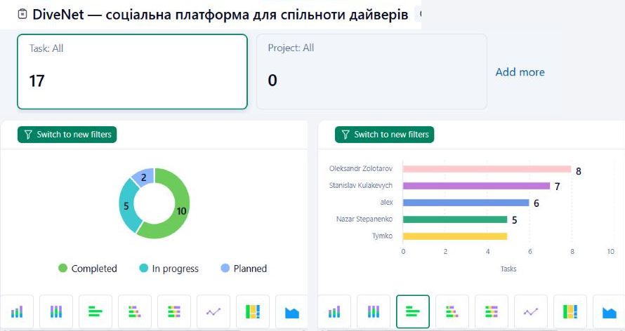{width=15cm}

Облік часу. Фактично витрачений час фіксується в картці завдання (таймер або ручний запис) і збирається в поданні Timelog. У журналі 4 записи загальним обсягом 19 год: функціональні вимоги – 6 год, системні вимоги – 4 год, back-end відгуків – 5 год, front-end – 4 год; кожен запис має дату й коментар про виконану роботу (рис. 4.6).

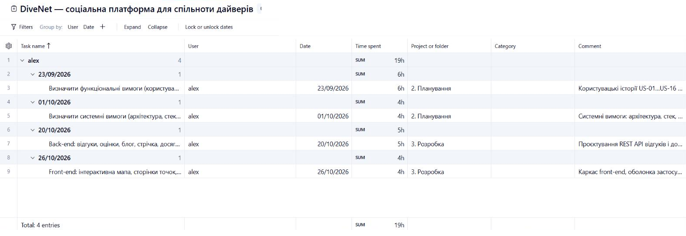{width=16.5cm}

## 4.7. Підсумок планування

У Wrike складено детальний план проєкту DiveNet: п’ять етапів, 17 завдань зі строками, відповідальними, статусами та розгорнутими описами. Кожне завдання пов’язане з вимогами, а завдання етапу планування мають прикріплені артефакти – звіти про планування та вимоги. План відображає стан проєкту на дату складання: етапи підготовки й планування завершено, автентифікацію та UI/UX-дизайн реалізовано, розробка решти підсистем триває. Канбан-дошка й діаграма Ганта із залежностями візуалізують хід робіт, подання «Ресурси» показує навантаження команди й виявляє перевантаження, аналітика підсумовує стан завдань, а журнал обліку часу фіксує фактичні трудовитрати.

# 5. Проєктування програмного продукту

У цьому розділі наведено проєктні моделі системи у нотації UML. Діаграми семи типів описують, хто і як користується системою, де розгорнуто її частини, як змінюються стани основних об'єктів, як перебігають ключові процеси та з яких класів і компонентів складається код. Усього розділ містить 26 рисунків, згрупованих за типами діаграм.

## 5.1. Діаграми варіантів використання

Ці діаграми показують, хто користується системою і чого хоче досягти. Варіантів використання багато, тому їх розбито за чотирма сферами. Дійових осіб три: гість, дайвер і адміністратор.

### 5.1.1. Перегляд каталогу та вхід у систему

{width=16.5cm}

Гість може вивчати DiveNet без облікового запису: дивитися мапу, шукати сайти, читати сторінки сайтів, стрічку дописів і профілі дайверів. Фільтри на мапі та вибір країни чи регіону у стрічці є необов'язковими розширеннями (`«extend»`), а показ лише дозволеного приватністю є обов'язковою частиною перегляду профілю (`«include»`). Стрілки узагальнення між акторами означають, що дайвер уміє все те саме, що й гість, а адміністратор – усе те саме, що й дайвер.

### 5.1.2. Внесок дайвера у спільноту

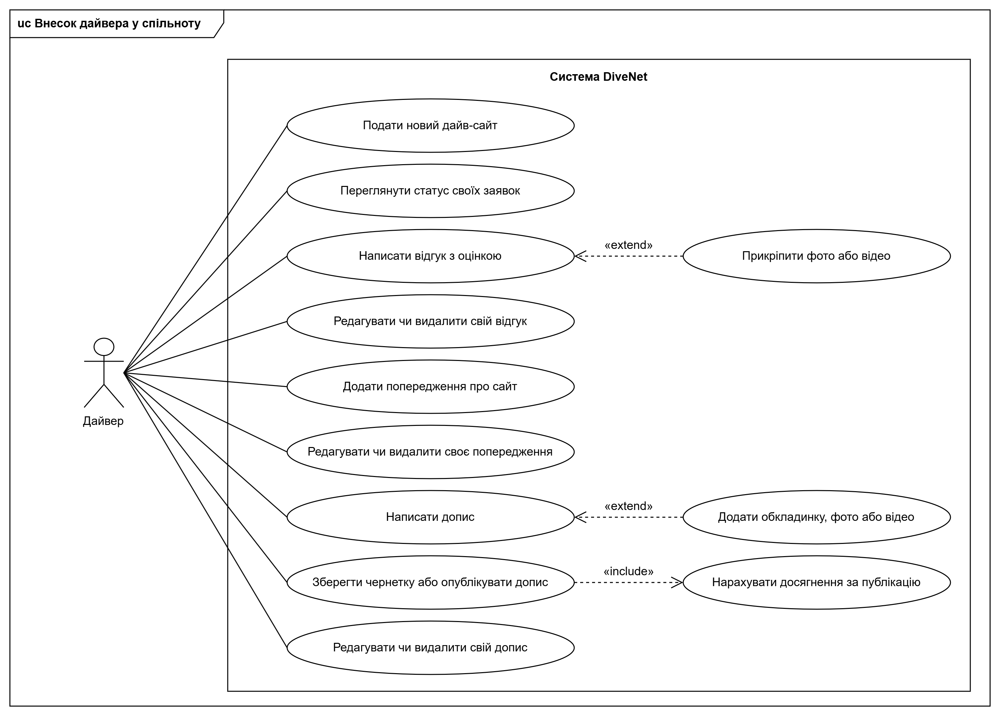{width=16.5cm}

Увійшовши в систему, дайвер наповнює її знаннями: подає нові сайти й стежить за статусом заявок, пише відгуки з оцінками, додає попередження та дописи. До відгуку й допису за бажанням можна прикріпити медіафайли. Свій контент автор може редагувати й видаляти, а публікація допису щоразу запускає нарахування досягнень.

### 5.1.3. Особистий кабінет дайвера

{width=16.5cm}

Дайвер редагує профіль і вирішує, що в ньому бачать інші, веде журнал занурень і шафку спорядження, заявляє сертифікати, переглядає статистику та досягнення. Кожен запис у журналі автоматично включає перевірку досягнень.

### 5.1.4. Модерація контенту

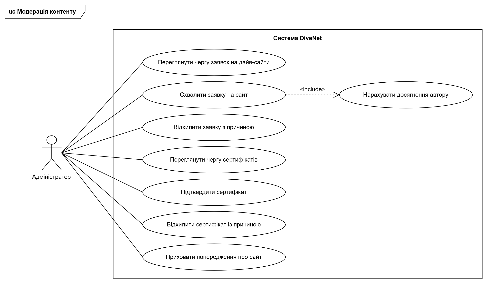{width=16.5cm}

Адміністратор стежить за якістю даних. Він працює з двома чергами, заявок на сайти та сертифікатів, і за кожною заявкою ухвалює рішення, а відхиляючи, вказує причину. Схвалення сайту водночас нараховує досягнення його авторові. Крім того, адміністратор може приховати попередження про сайт.

## 5.2. Діаграма розгортання

Діаграма розгортання показує, на якому обладнанні та в яких середовищах виконуються частини системи і як вони зв'язані мережею.

### 5.2.1. Розгортання системи DiveNet

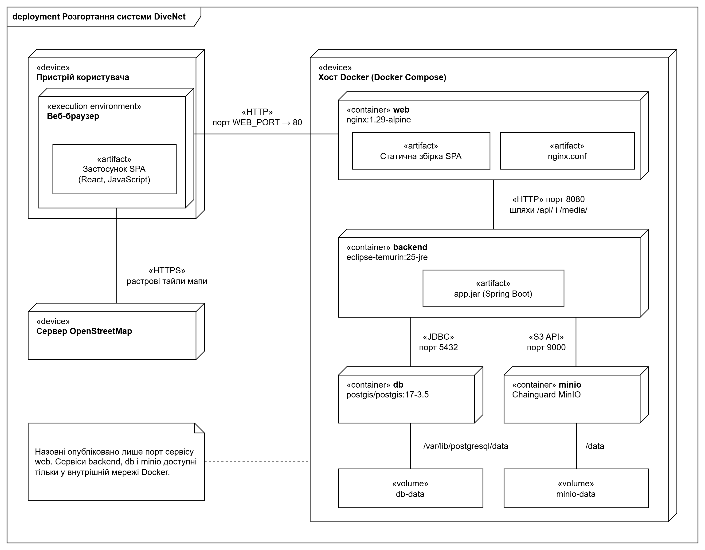{width=16.5cm}

Користувач відкриває застосунок у браузері, а той звертається лише до двох адрес: до тайлів мапи OpenStreetMap і до контейнера `web` на хості Docker. Контейнер `web` (nginx) віддає статичну збірку SPA, а запити за шляхами `/api/` і `/media/` передає контейнеру `backend` із застосунком Spring Boot. `backend` зберігає записи в базі `db` через JDBC, а файли – у сховищі `minio` через S3 API, і обидва сервіси тримають дані в іменованих томах, які переживають перезапуск контейнерів. Назовні опубліковано лише порт `web`, а решта сервісів доступна тільки у внутрішній мережі Docker. У поточній конфігурації браузер звертається до `web` за протоколом HTTP, без TLS.

## 5.3. Діаграми станів

Діаграми станів описують життєвий цикл одного об'єкта: у яких станах він буває, які події переводять його далі та за яких умов. Тут показано п'ять об'єктів, поведінка яких залежить від стану.

### 5.3.1. Життєвий цикл дайв-сайту

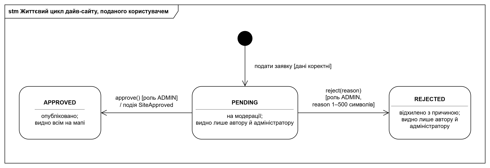{width=16.5cm}

Сайт, поданий дайвером, спочатку перебуває в стані `PENDING`: його бачать лише автор і адміністратор. Далі адміністратор ухвалює одне з двох рішень. Після `approve()` сайт стає `APPROVED`, з'являється на мапі для всіх, а подія `SiteApproved` запускає нарахування досягнень. Після `reject(reason)` сайт стає `REJECTED` і зберігає причину відхилення довжиною від 1 до 500 символів. Обидва рішення остаточні, бо зі станів `APPROVED` і `REJECTED` переходів немає.

### 5.3.2. Життєвий цикл сертифіката

{width=16.5cm}

Заявлений сертифікат очікує перевірки в стані `PENDING`, після чого адміністратор підтверджує його (`VERIFIED`, у профілі з'являється значок) або відхиляє із причиною (`REJECTED`). Будь-яка зміна даних через `update()` повертає сертифікат у `PENDING`, і адміністратор перевіряє його знову. Власник може видалити сертифікат із будь-якого стану.

### 5.3.3. Життєвий цикл допису

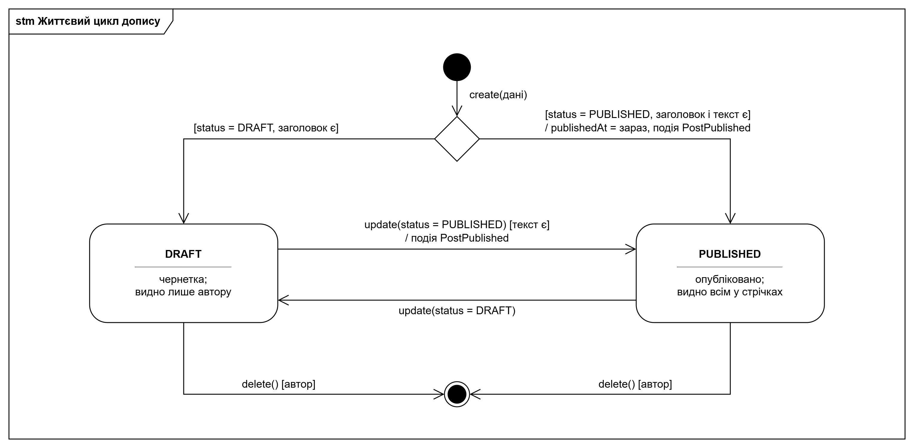{width=16.5cm}

Під час створення автор одразу обирає шлях, що показано вузлом вибору. Чернетці `DRAFT` достатньо заголовка, і її бачить лише автор, а для стану `PUBLISHED` потрібен ще й текст, і тоді допис потрапляє у стрічки. Чернетку можна опублікувати пізніше, а опублікований допис – повернути в чернетки. Кожен перехід у `PUBLISHED` надсилає подію `PostPublished`, за якою нараховуються досягнення. Автор може видалити допис в обох станах.

### 5.3.4. Життєвий цикл токена оновлення сесії

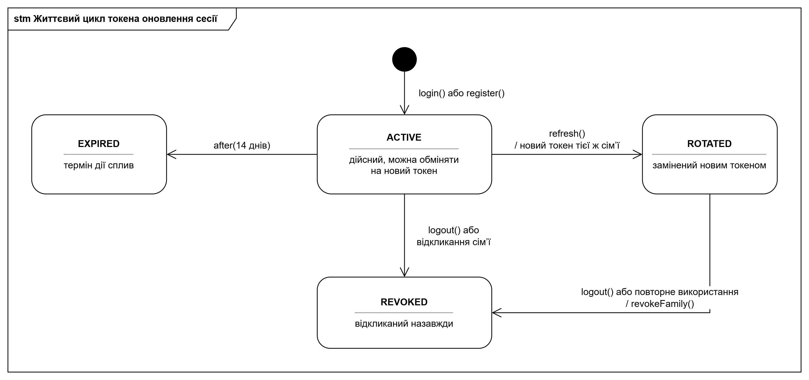{width=16.5cm}

Токен оновлення з'являється у стані `ACTIVE` під час входу або реєстрації й живе 14 днів, після чого переходить в `EXPIRED`. Кожне оновлення сесії замінює його новим токеном тієї ж «сім'ї», а старий стає `ROTATED`. Якщо хтось пред'являє вже замінений токен, це ознака викрадення, тому система відкликає всю сім'ю, і токени переходять у `REVOKED`. Той самий кінцевий стан настає після виходу із системи.

### 5.3.5. Життєвий цикл завантаженого файлу

{width=16.5cm}

Файл завантажується раніше, ніж зберігається відгук чи допис, тому спершу він перебуває в стані `UNATTACHED`. Коли автор зберігає контент, файл переходить в `ATTACHED`. Якщо ж користувач покинув форму, через 24 години файл видаляє фонове очищення `MediaCleanup`, тож сховище не заповнюється непотрібними файлами. Прив'язаний файл зникає, коли контент, якому він належав, його звільняє (`release`).

## 5.4. Діаграми діяльності

Діаграми діяльності показують перебіг процесу від початку до кінця, а доріжки вказують, хто виконує кожен крок.

### 5.4.1. Пошук і фільтрація дайв-сайтів

{width=16.5cm}

Користувач відкриває мапу, а застосунок зчитує критерії пошуку з URL, тому посиланням на результат можна поділитися. Кожна зміна фільтрів записується в URL і перетворюється на запит, до якого застосунок додає коди регіонів і країн для поточної мови інтерфейсу. Сервер відбирає лише затверджені сайти й сортує їх, а застосунок оновлює маркери, картки й лічильник або повідомляє, що нічого не знайдено. Користувач уточнює критерії доти, доки результат його не влаштує.

### 5.4.2. Подання та модерація дайв-сайту

{width=16.5cm}

Дайвер заповнює форму й виправляє помилки, доки дані не стануть коректними, після чого сайт зберігається зі статусом `PENDING`. Адміністратор відкриває чергу, перевіряє дані й розташування та ухвалює рішення. За схвалення система оцінює досягнення автора, а сайт з'являється на мапі. За відхилення дайвер бачить статус і причину.

### 5.4.3. Заявлення та перевірка сертифіката

{width=16.5cm}

Дайвер вказує агентство, рівень і номер сертифіката та за бажанням додає фото. Система приймає коректну заявку зі статусом `PENDING`, а адміністратор звіряє номер і фото. Після підтвердження дайвер отримує значок. Побачивши причину відхилення, дайвер може виправити дані й подати сертифікат знову.

### 5.4.4. Написання та публікація допису

{width=16.5cm}

Автор пише текст, додає медіа, регіон і сайт, а потім обирає, зберегти чернетку чи опублікувати. Редактор у браузері перевіряє форму: заголовок потрібен завжди, а текст лише для публікації. Сервер прив'язує медіа й зберігає допис, після чого шляхи розходяться. Чернетка знову відкривається в редакторі, а публікація фіксує час, надсилає подію `PostPublished`, оцінює досягнення автора й відкриває готову сторінку допису.

## 5.5. Діаграми взаємодії: діаграми послідовності

Діаграми послідовності належать до сімейства діаграм взаємодії. Вони показують, якими повідомленнями й у якому порядку обмінюються об'єкти під час одного сценарію. На рисунках наведено імена класів і методів із вихідного коду.

### 5.5.1. Вхід у систему

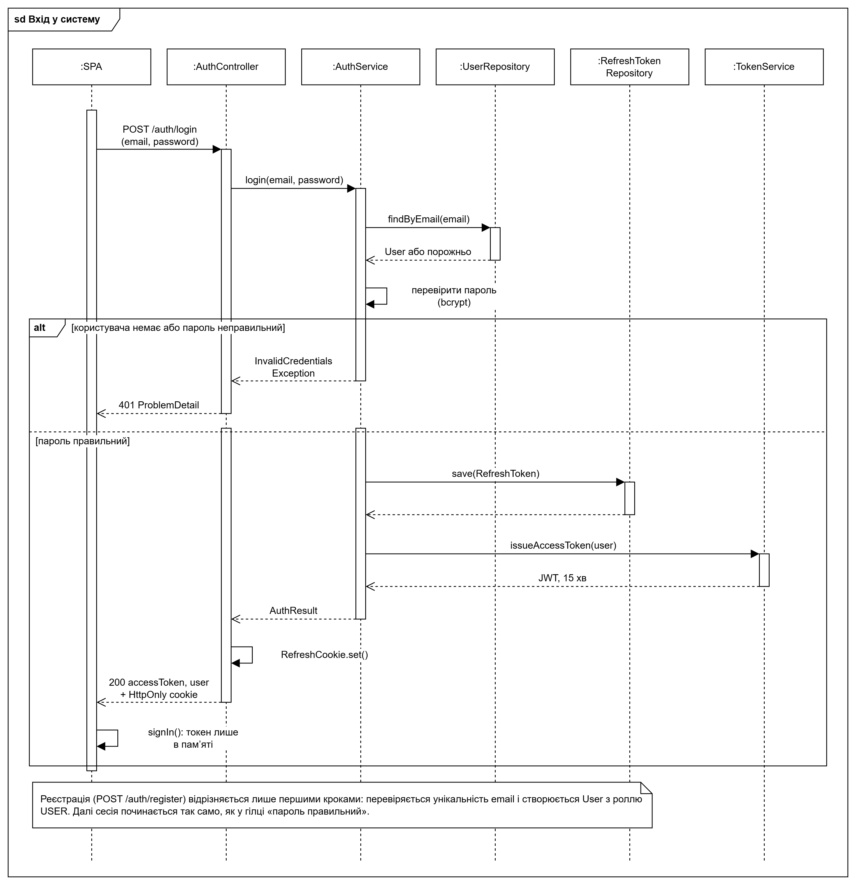{width=16.5cm}

SPA надсилає email і пароль, а `AuthService` знаходить користувача й перевіряє пароль через bcrypt. Помилка однакова для неіснуючого email і неправильного пароля, тож за відповіддю не можна дізнатися, хто зареєстрований. За правильного пароля створюється токен оновлення та JWT на 15 хвилин. Токен оновлення повертається в HttpOnly cookie, недоступному для JavaScript, а access-токен застосунок тримає лише в пам'яті.

### 5.5.2. Тихе оновлення сесії

{width=16.5cm}

Коли запит отримує відповідь 401, API-клієнт непомітно для користувача звертається по новий токен. `AuthService` читає запис із блокуванням рядка, тож два одночасні оновлення не обробляться двічі, і далі можливі три гілки. Недійсний токен завершує сесію. Повторно використаний токен спричиняє відкликання всієї сім'ї. Дійсний токен замінюється новим, після чого початковий запит автоматично повторюється.

### 5.5.3. Завантаження зображення

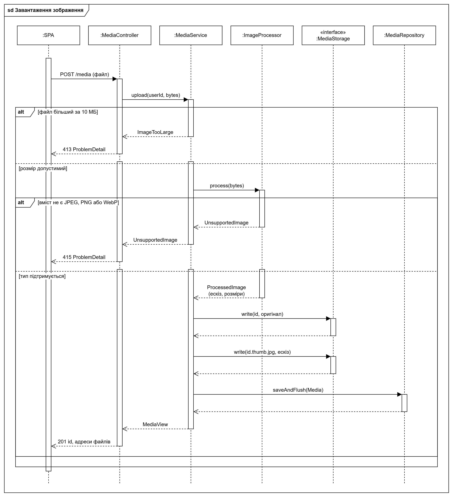{width=16.5cm}

`MediaService` спочатку відсікає файли, більші за 10 МБ, а `ImageProcessor` визначає тип за вмістом файлу і приймає лише JPEG, PNG та WebP. Для коректного файлу створюється ескіз, після чого оригінал і ескіз записуються через інтерфейс `MediaStorage`, а опис файлу – у базу. Клієнт отримує ідентифікатор і пізніше передає його разом із відгуком чи дописом.

### 5.5.4. Написання відгуку та оновлення рейтингу

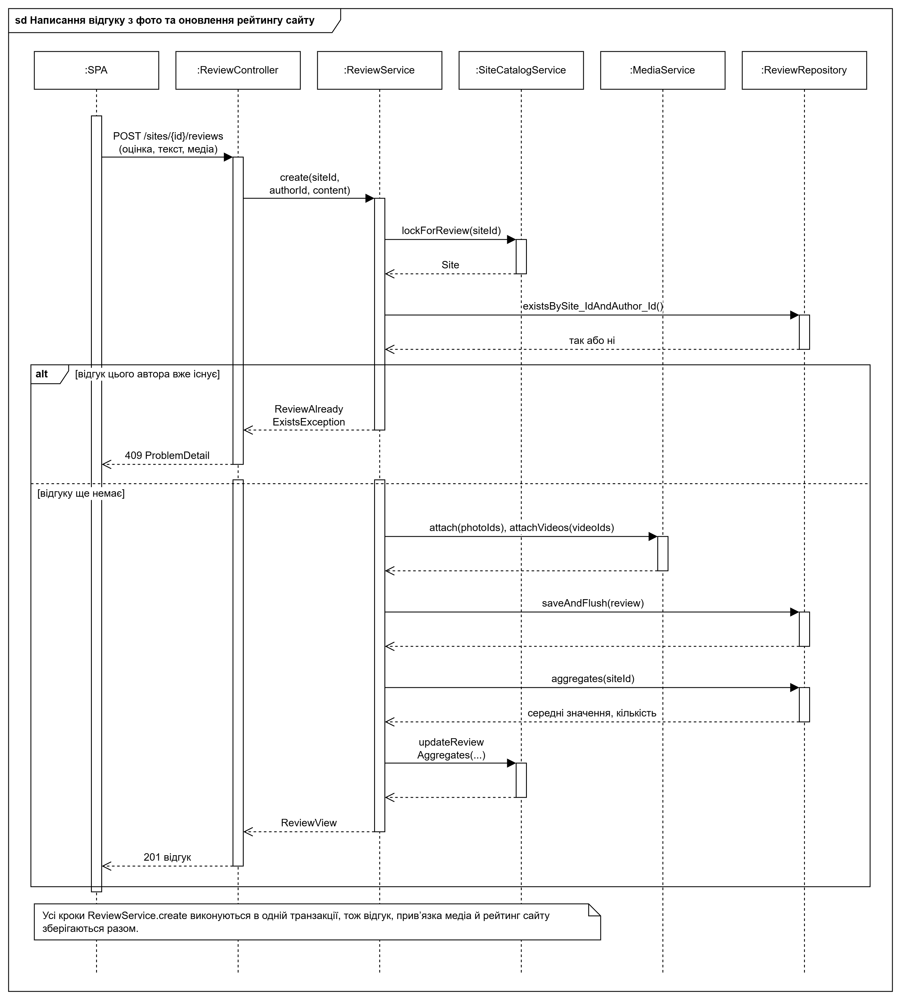{width=16.5cm}

`ReviewService` спочатку блокує сайт, щоб одночасні відгуки не зіпсували його рейтинг, і перевіряє, чи цей автор ще не залишав відгуку. Другий відгук від одного автора відхиляється відповіддю 409. Інакше медіа прив'язуються, відгук зберігається, а середні значення перераховуються й записуються в сайт. Усе це одна транзакція, тому відгук, файли й рейтинг змінюються разом.

### 5.5.5. Запис занурення та нарахування досягнень

{width=16.5cm}

`DiveLogService` зберігає запис і публікує подію `DiveLogged`. Після підтвердження транзакції `AchievementListener` запускає оцінювання, а `AchievementService` підраховує показники й у циклі нараховує кожне досягнення, ціль якого виконано. Нарахування має окрему транзакцію, тому збій у ньому не скасовує збереженого занурення. Так само працюють події `PostPublished` і `SiteApproved`.

## 5.6. Діаграми класів

Діаграми класів показують структуру даних і зв'язки між ними. Модель розбито за предметними сферами. Прямокутники лише з назвою (`User`, `Site`, `Region`) – це класи, докладно описані на іншому рисунку.

### 5.6.1. Каталог дайв-сайтів і географія

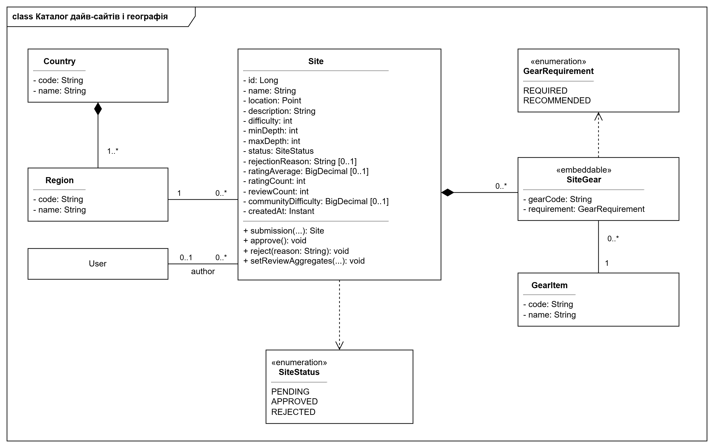{width=16.5cm}

Клас `Site` містить координати, глибини, складність, статус модерації та обчислені показники рейтингу. Кожен сайт належить одному регіону, регіони складають країну, а автор є необов'язковим, бо не всі сайти подані користувачами. Вимоги до спорядження описує вбудований клас `SiteGear`, який зв'язує сайт із довідником `GearItem` і вказує, обов'язковий це предмет чи рекомендований.

### 5.6.2. Контент спільноти та медіафайли

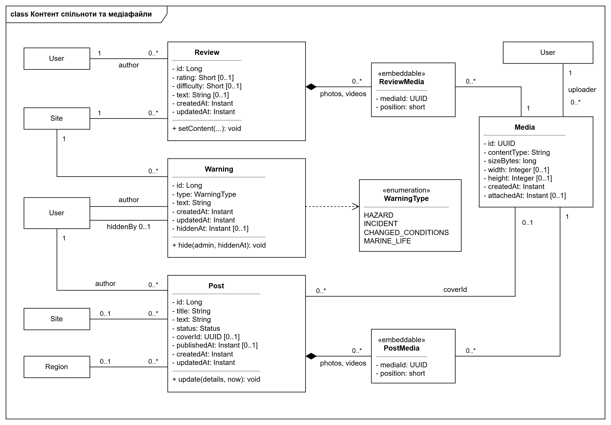{width=16.5cm}

Кожен із трьох видів контенту має автора. `Review` і `Warning` завжди належать сайту, а `Post` може бути пов'язаний із сайтом чи регіоном. `Warning` окремо запам'ятовує адміністратора, який його приховав. Файли відгуків і дописів описують вбудовані класи `ReviewMedia` і `PostMedia`, які зберігають ще й порядок показу. Сам `Media` знає завантажувача й час прив'язки, від якого залежить його очищення.

### 5.6.3. Обліковий запис і діяльність дайвера

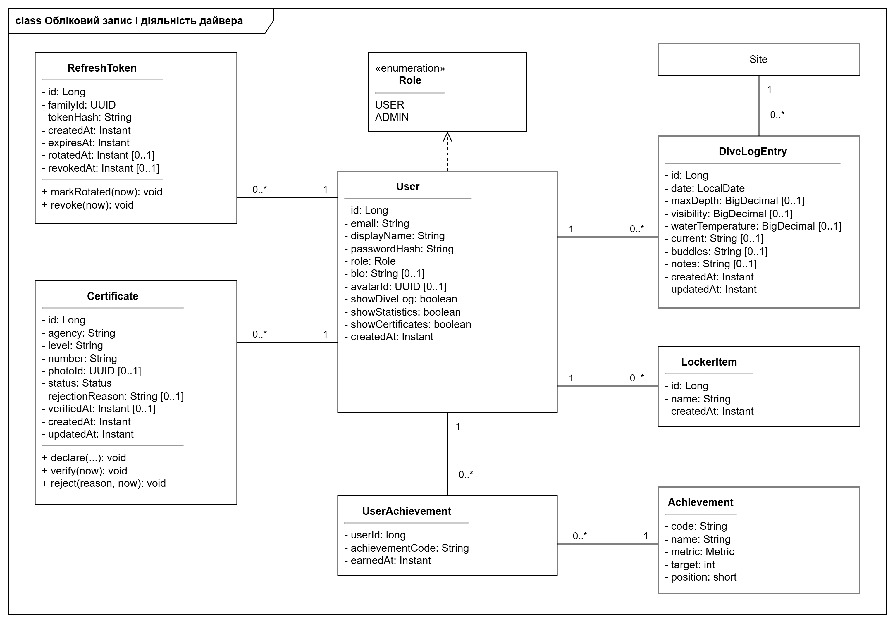{width=16.5cm}

Клас `User` зберігає роль і налаштування приватності. Ліворуч показано безпеку та підтвердження кваліфікації: токени оновлення й сертифікати. Праворуч показано особисту діяльність: записи журналу, кожен про конкретний сайт, і предмети шафки спорядження. Клас `UserAchievement` з'єднує користувача з довідником `Achievement` і зберігає час отримання.

### 5.6.4. Шари back-end на прикладі відгуків

{width=16.5cm}

Рисунок показує будову коду на прикладі модуля відгуків. Решту модулів організовано так само. Шар `web` приймає `ReviewRequest` і повертає `ReviewResponse` через контролер. Шар `service` містить правила й транзакції та звертається до інших модулів лише через їхні сервіси: каталогу сайтів, медіа та сертифікатів. Шар `domain` містить сутність і репозиторій. Усі залежності спрямовані згори вниз, а внутрішні сутності не потрапляють у відповіді API, бо між шарами передається `ReviewView`.

## 5.7. Діаграми компонентів

Діаграми компонентів показують, із яких замінних частин складається система і які інтерфейси ті надають одна одній. Рисунки йдуть від загального до деталей.

### 5.7.1. Складові системи DiveNet

{width=16.5cm}

SPA отримує тайли мапи від OpenStreetMap, а все інше – через nginx, який проксіює REST API до back-end. Усередині back-end запит проходить компоненти `web`, `service` і `domain`, а останній працює з PostgreSQL через JDBC. Для роботи з файлами `service` використовує інтерфейс `MediaStorage`, який має дві реалізації: диск і MinIO. Параметр `divenet.media.storage` обирає потрібну без зміни бізнес-логіки.

### 5.7.2. Модулі back-end та їхні залежності

{width=16.5cm}

Back-end поділено на предметні модулі, і стрілки показують, хто кого використовує. Модуль `achievement` реагує на події журналу, дописів і сайтів. Від модуля `site` залежать `achievement`, `divelog`, `post`, `review` і `warning`. Файлами `post`, `review` і `user` користуються через модуль `media`. Примітка на рисунку перелічує залежності, які не показано: від `user`, `shared` і `demo`.

### 5.7.3. Структура застосунку в браузері

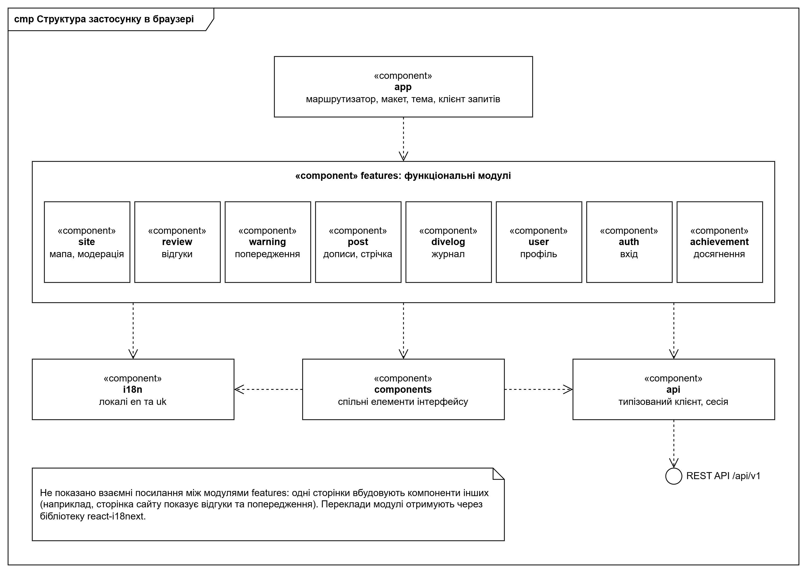{width=16.5cm}

Компонент `app` запускає застосунок: маршрутизатор, макет, тему та клієнт запитів. Він підключає функціональні модулі `features`, які майже повторюють модулі back-end. Усі вони спираються на три спільні частини: `i18n` із перекладами англійською та українською, `components` зі спільними елементами інтерфейсу та `api` із типізованим клієнтом. Лише `api` звертається до REST API, тому мережевий обмін і робота із сесією зосереджені в одному місці.

## 5.8. Використані програмні засоби

Усі діаграми побудовано в редакторі draw.io (diagrams.net).


# Висновки

У результаті виконання проєкту створено вебплатформу DiveNet, яка поєднує каталог дайв-сайтів на мапі, відгуки й попередження, журнал занурень із досягненнями, профілі із сертифікатами та дописи зі стрічками. Реалізовано всі 20 користувацьких історій із підрозділу 2.2. Інтерфейс доступний англійською та українською мовами, у світлій і темній темах, на мобільних пристроях і комп'ютерах.

Серверну частину побудовано як шаровий моноліт із відокремленими модулями замість мікросервісів, передбачених початковим планом. Клієнт і сервер узгоджено через спільний контракт API. Система розгортається однією командою разом із демонстраційними даними.

Працездатність системи перевіряється понад 800 автоматизованими тестами. Разом із тестами продуктивності, перевіркою доступності за WCAG 2.1 AA та скануванням вразливостей вони виконуються в CI для кожної зміни коду.

# Перелік скорочень

**API** (Application Programming Interface) – прикладний програмний інтерфейс.

**CI** (Continuous Integration) – безперервна інтеграція: автоматична перевірка кожної зміни коду.

**CMAS** (Confédération Mondiale des Activités Subaquatiques) – Всесвітня конфедерація підводної діяльності.

**DEMA** (Diving Equipment & Marketing Association) – міжнародна асоціація спорядження та маркетингу для дайвінгу.

**DTO** (Data Transfer Object) – об'єкт для передавання даних між шарами або через API.

**E2E** (End-to-End) – наскрізне тестування системи через інтерфейс користувача.

**JWT** (JSON Web Token) – підписаний токен доступу.

**PADI** (Professional Association of Diving Instructors) – професійна асоціація інструкторів з дайвінгу.

**QA** (Quality Assurance) – забезпечення якості програмного забезпечення.

**REST** (Representational State Transfer) – архітектурний стиль вебінтерфейсів на основі ресурсів і методів HTTP.

**SPA** (Single-Page Application) – односторінковий вебзастосунок.

**SSI** (Scuba Schools International) – міжнародна система сертифікації та навчання підводного плавання.

**UI/UX** (User Interface / User Experience) – інтерфейс користувача та користувацький досвід.

**UML** (Unified Modeling Language) – уніфікована мова моделювання.

**WCAG** (Web Content Accessibility Guidelines) – настанови з доступності вебконтенту.

# Список джерел

1. DEMA. DEMA Publishes Most Recent Dive Consumer Survey Data. URL: https://www.dema.org/news/637774/DEMA-Publishes-Most-Recent-Dive-Consumer-Survey-Data.htm
2. Professional Association of Diving Instructors. Wikipedia. URL: https://en.wikipedia.org/wiki/Professional_Association_of_Diving_Instructors
3. Fortune Business Insights. Diving Tourism Market. URL: https://www.fortunebusinessinsights.com/diving-tourism-market-109878
4. Web Content Accessibility Guidelines (WCAG) 2.1. W3C. URL: https://www.w3.org/TR/WCAG21/
5. RFC 9457. Problem Details for HTTP APIs. URL: https://www.rfc-editor.org/rfc/rfc9457
