# Проєктування системи DiveNet засобами UML

DiveNet — це соціальна вебплатформа для дайверів. Вона поєднує мапу дайв-сайтів із пошуком і фільтрами, відгуки та попередження про сайти, журнал занурень, профілі із сертифікатами й досягненнями, а також дописи зі стрічками. Систему побудовано як React-застосунок у браузері та моноліт на Spring Boot із шарами `web → service → domain`, а дані зберігаються в PostgreSQL/PostGIS і MinIO. Нижче процеси та складові системи описано за допомогою семи типів діаграм UML, усього 26 рисунків.

## 1. Діаграми варіантів використання

Ці діаграми показують, хто користується системою і чого хоче досягти. Варіантів використання багато, тому їх розбито за чотирма сферами. Дійових осіб три: гість, дайвер і адміністратор.

### 1.1. Перегляд каталогу та вхід у систему

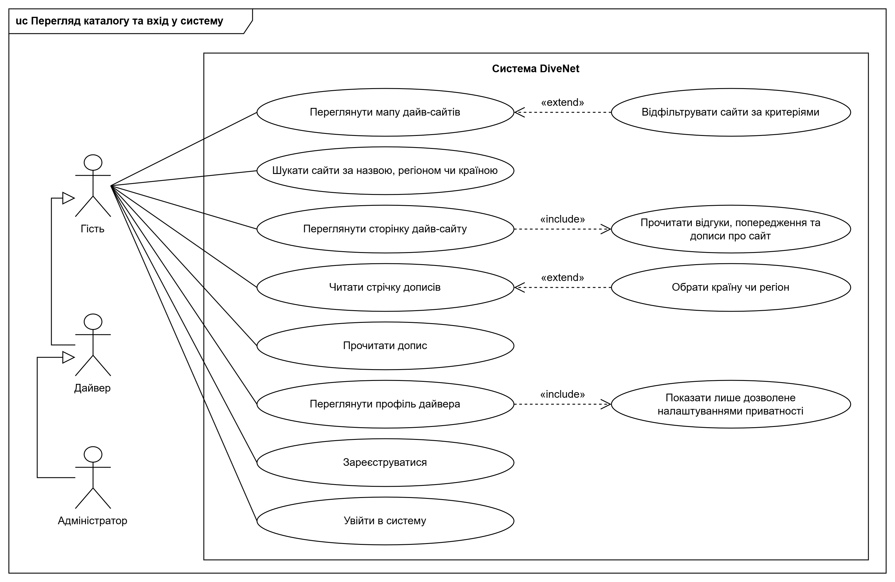

*Рисунок 1.1 — Перегляд каталогу та вхід у систему*

Гість може вивчати DiveNet без облікового запису: дивитися мапу, шукати сайти, читати сторінки сайтів, стрічку дописів і профілі дайверів. Фільтри на мапі та вибір країни чи регіону у стрічці є необов'язковими розширеннями (`«extend»`), а показ лише дозволеного приватністю є обов'язковою частиною перегляду профілю (`«include»`). Стрілки узагальнення між акторами означають, що дайвер уміє все те саме, що й гість, а адміністратор — усе те саме, що й дайвер.

### 1.2. Внесок дайвера у спільноту

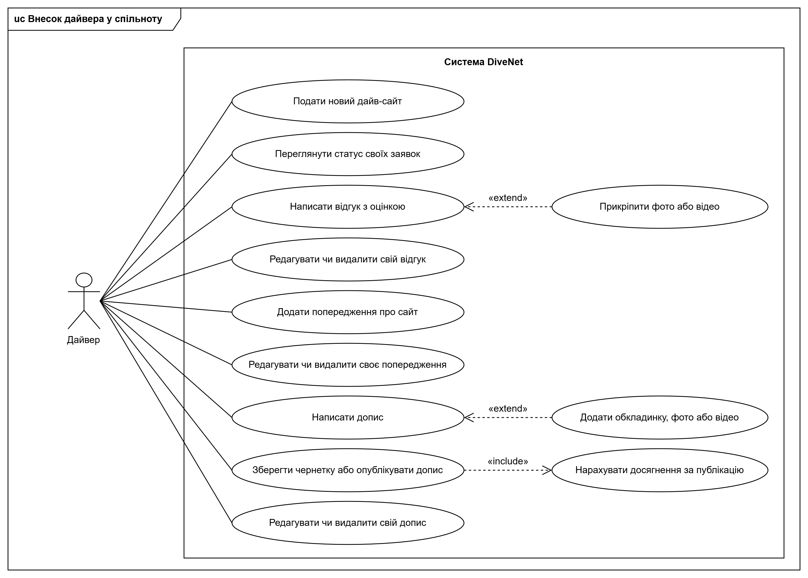

*Рисунок 1.2 — Внесок дайвера у спільноту*

Увійшовши в систему, дайвер наповнює її знаннями: подає нові сайти й стежить за статусом заявок, пише відгуки з оцінками, додає попередження та дописи. До відгуку й допису за бажанням можна прикріпити медіафайли. Свій контент автор може редагувати й видаляти, а публікація допису щоразу запускає нарахування досягнень.

### 1.3. Особистий кабінет дайвера

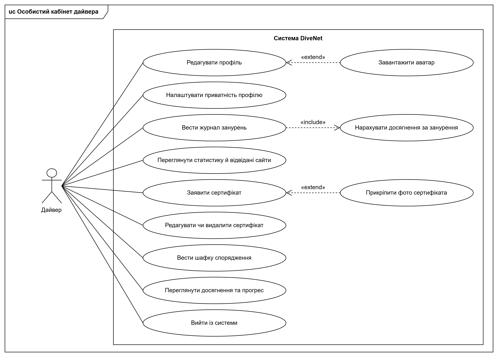

*Рисунок 1.3 — Особистий кабінет дайвера*

Тут зібрано все, що дайвер робить для себе: редагує профіль і вирішує, що в ньому бачать інші, веде журнал занурень і шафку спорядження, заявляє сертифікати, переглядає статистику та досягнення. Кожен запис у журналі автоматично включає перевірку досягнень, тому дайверу не потрібно нічого отримувати вручну.

### 1.4. Модерація контенту

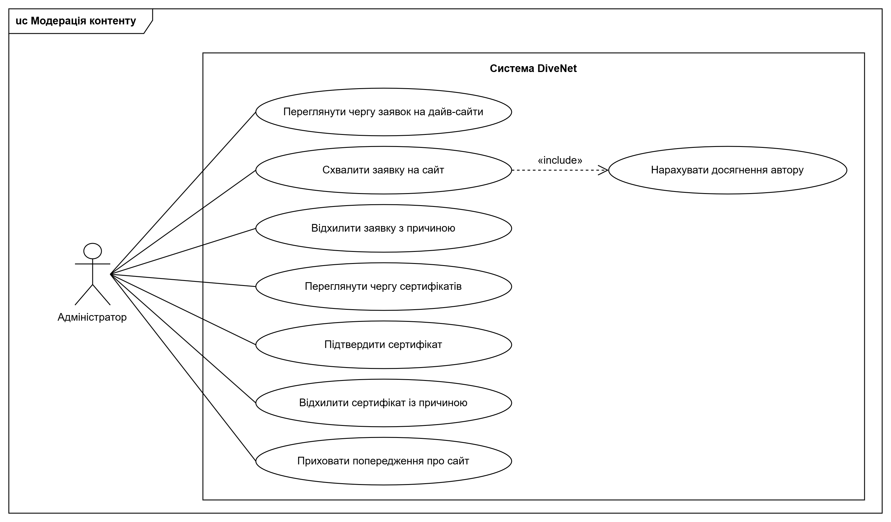

*Рисунок 1.4 — Модерація контенту*

Адміністратор стежить за якістю даних. Він працює з двома чергами, заявок на сайти та сертифікатів, і за кожною заявкою ухвалює рішення, а відхиляючи, вказує причину. Схвалення сайту водночас нараховує досягнення його авторові. Крім того, адміністратор може приховати попередження про сайт.

## 2. Діаграма розгортання

Діаграма розгортання показує, на якому обладнанні та в яких середовищах виконуються частини системи і як вони зв'язані мережею.

### 2.1. Розгортання системи DiveNet

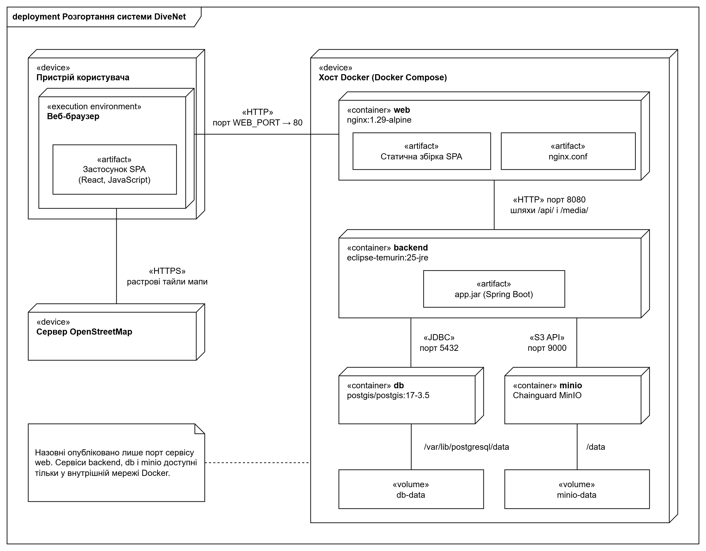

*Рисунок 2.1 — Розгортання системи DiveNet*

Користувач відкриває застосунок у браузері, а той звертається лише до двох адрес: до тайлів мапи OpenStreetMap і до контейнера `web` на хості Docker. Контейнер `web` (nginx) віддає статичну збірку SPA, а запити за шляхами `/api/` і `/media/` передає контейнеру `backend` із застосунком Spring Boot. `backend` зберігає записи в базі `db` через JDBC, а файли — у сховищі `minio` через S3 API, і обидва сервіси тримають дані в іменованих томах, які переживають перезапуск контейнерів. Назовні опубліковано лише порт `web`, а решта сервісів доступна тільки у внутрішній мережі Docker. Зв'язок із браузером показано як HTTP, бо саме так налаштовано стек Docker Compose: TLS у ньому немає.

## 3. Діаграми станів

Діаграми станів описують життєвий цикл одного об'єкта: у яких станах він буває, які події переводять його далі та за яких умов. Тут показано п'ять об'єктів, поведінка яких справді залежить від стану.

### 3.1. Життєвий цикл дайв-сайту

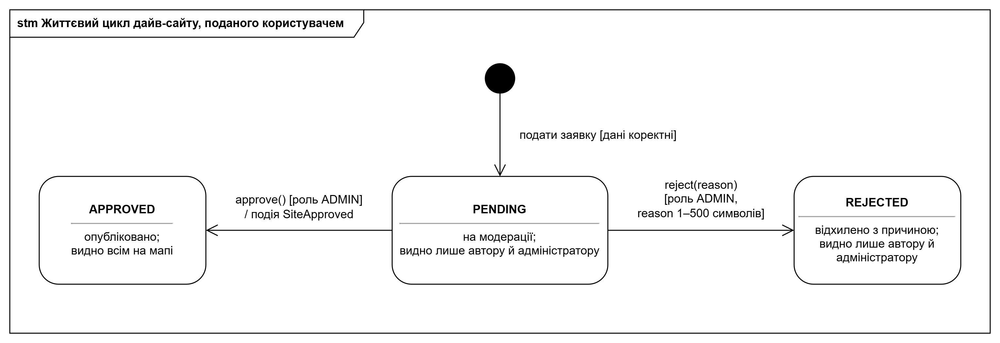

*Рисунок 3.1 — Життєвий цикл дайв-сайту, поданого користувачем*

Сайт, поданий дайвером, спочатку перебуває в стані `PENDING`: його бачать лише автор і адміністратор. Далі адміністратор ухвалює одне з двох рішень. Після `approve()` сайт стає `APPROVED`, з'являється на мапі для всіх, а подія `SiteApproved` запускає нарахування досягнень. Після `reject(reason)` сайт стає `REJECTED` і зберігає причину відхилення довжиною від 1 до 500 символів. Обидва рішення остаточні, бо зі станів `APPROVED` і `REJECTED` переходів немає.

### 3.2. Життєвий цикл сертифіката

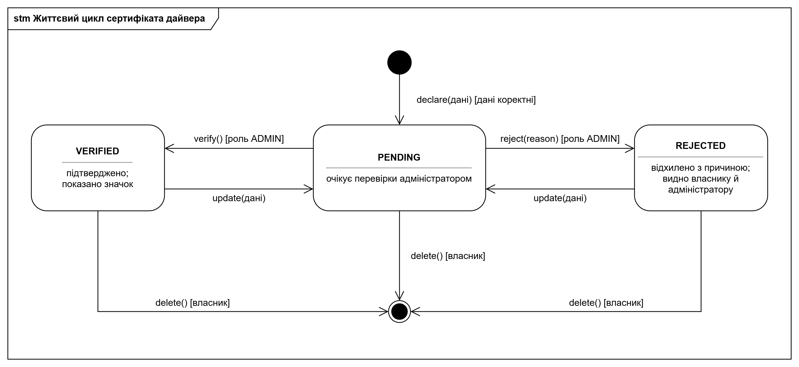

*Рисунок 3.2 — Життєвий цикл сертифіката дайвера*

Заявлений сертифікат очікує перевірки в стані `PENDING`, після чого адміністратор підтверджує його (`VERIFIED`, у профілі з'являється значок) або відхиляє із причиною (`REJECTED`). Головна ідея цієї діаграми у зворотних переходах: будь-яка зміна даних через `update()` повертає сертифікат у `PENDING`. Отже, значок не може залишитися на даних, яких ніхто не перевіряв. Власник може видалити сертифікат із будь-якого стану.

### 3.3. Життєвий цикл допису

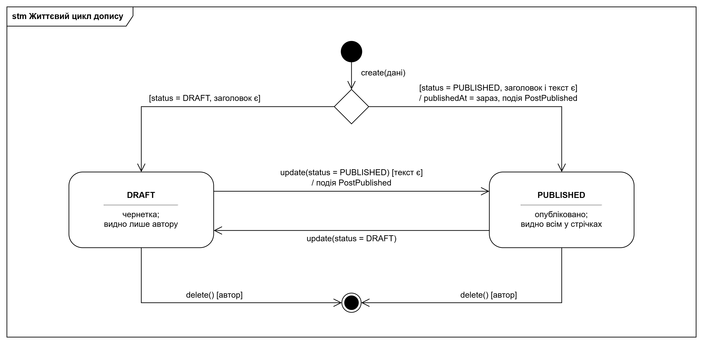

*Рисунок 3.3 — Життєвий цикл допису*

Під час створення автор одразу обирає шлях, що показано вузлом вибору. Чернетці `DRAFT` достатньо заголовка, і її бачить лише автор, а для стану `PUBLISHED` потрібен ще й текст, і тоді допис потрапляє у стрічки. Чернетку можна опублікувати пізніше, а опублікований допис — повернути в чернетки. Кожен перехід у `PUBLISHED` надсилає подію `PostPublished`, за якою нараховуються досягнення. Автор може видалити допис в обох станах.

### 3.4. Життєвий цикл токена оновлення сесії

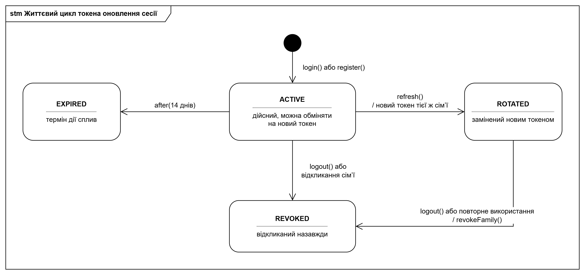

*Рисунок 3.4 — Життєвий цикл токена оновлення сесії*

Токен оновлення з'являється у стані `ACTIVE` під час входу або реєстрації й живе 14 днів, після чого переходить в `EXPIRED`. Кожне оновлення сесії замінює його новим токеном тієї ж «сім'ї», а старий стає `ROTATED`. Якщо хтось пред'являє вже замінений токен, це ознака викрадення, тому система відкликає всю сім'ю, і токени переходять у `REVOKED`. Той самий кінцевий стан настає після виходу із системи.

### 3.5. Життєвий цикл завантаженого файлу

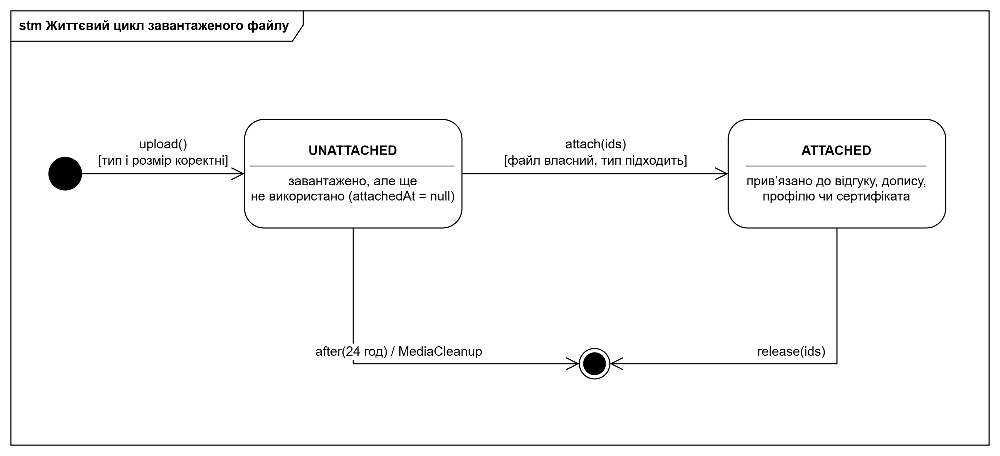

*Рисунок 3.5 — Життєвий цикл завантаженого файлу*

Файл завантажується раніше, ніж зберігається відгук чи допис, тому спершу він «нічийний», у стані `UNATTACHED`. Коли автор зберігає контент, файл переходить в `ATTACHED`. Якщо ж користувач покинув форму, через 24 години файл видаляє фонове очищення `MediaCleanup`, тож сховище не заповнюється непотрібними файлами. Прив'язаний файл зникає, коли контент, якому він належав, його звільняє (`release`).

## 4. Діаграми діяльності

Діаграми діяльності показують перебіг процесу від початку до кінця, а доріжки вказують, хто виконує кожен крок.

### 4.1. Пошук і фільтрація дайв-сайтів

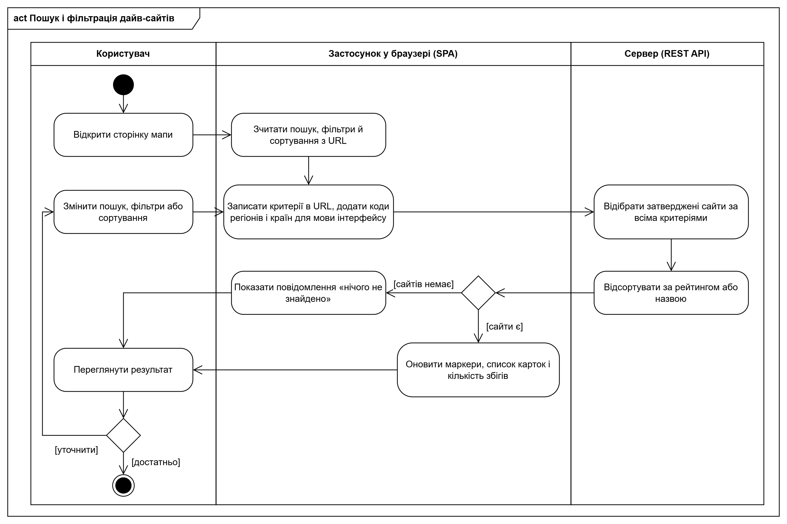

*Рисунок 4.1 — Пошук і фільтрація дайв-сайтів*

Користувач відкриває мапу, а застосунок зчитує критерії пошуку з URL, тому посиланням на результат можна поділитися. Кожна зміна фільтрів записується в URL і перетворюється на запит, до якого застосунок додає коди регіонів і країн для поточної мови інтерфейсу. Сервер відбирає лише затверджені сайти й сортує їх, а застосунок оновлює маркери, картки й лічильник або повідомляє, що нічого не знайдено. Користувач уточнює критерії доти, доки результат його не влаштує.

### 4.2. Подання та модерація дайв-сайту

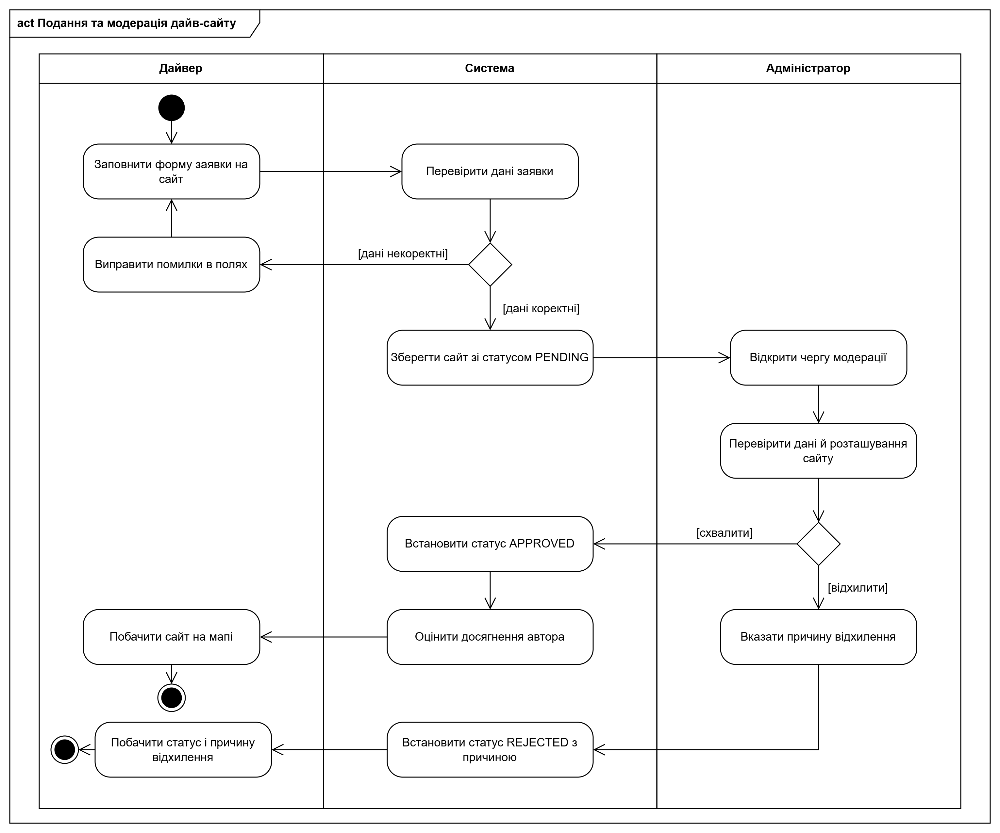

*Рисунок 4.2 — Подання та модерація дайв-сайту*

Цей процес об'єднує двох людей через систему. Дайвер заповнює форму й виправляє помилки, доки дані не стануть коректними, після чого сайт зберігається зі статусом `PENDING`. Адміністратор відкриває чергу, перевіряє дані й розташування та ухвалює рішення. За схвалення система оцінює досягнення автора, а сайт з'являється на мапі. За відхилення дайвер бачить статус і причину.

### 4.3. Заявлення та перевірка сертифіката

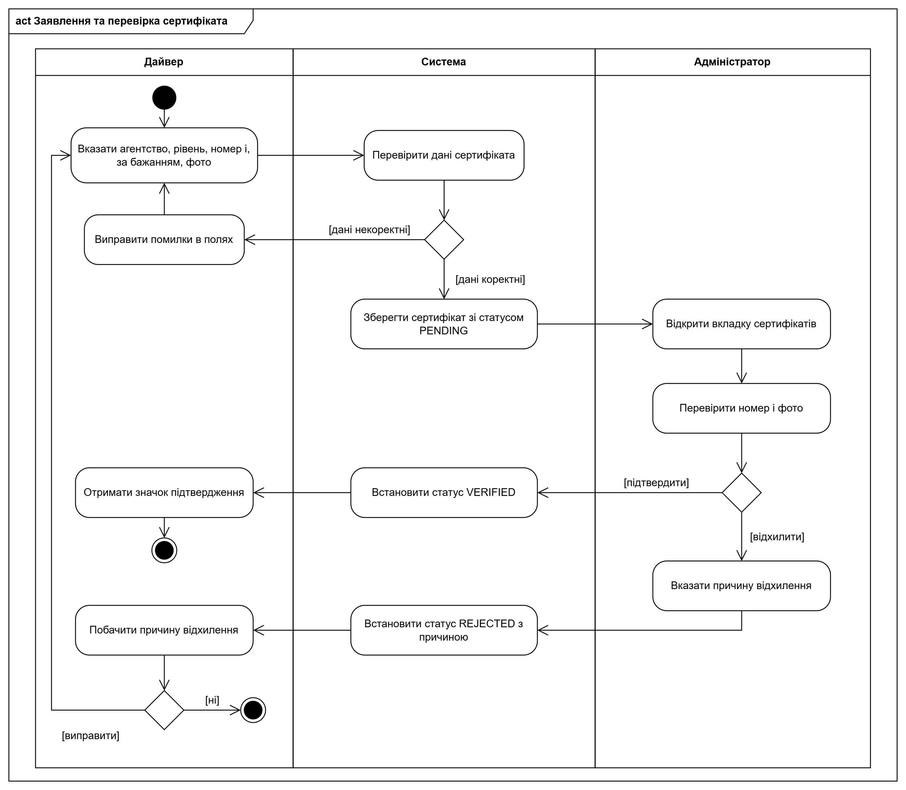

*Рисунок 4.3 — Заявлення та перевірка сертифіката*

Дайвер вказує агентство, рівень і номер сертифіката та за бажанням додає фото. Система приймає коректну заявку зі статусом `PENDING`, а адміністратор звіряє номер і фото. Після підтвердження дайвер отримує значок. На відміну від заявки на сайт, відхилення тут не обов'язково кінець: побачивши причину, дайвер може виправити дані й подати сертифікат знову, що показано довгою лінією повернення.

### 4.4. Написання та публікація допису

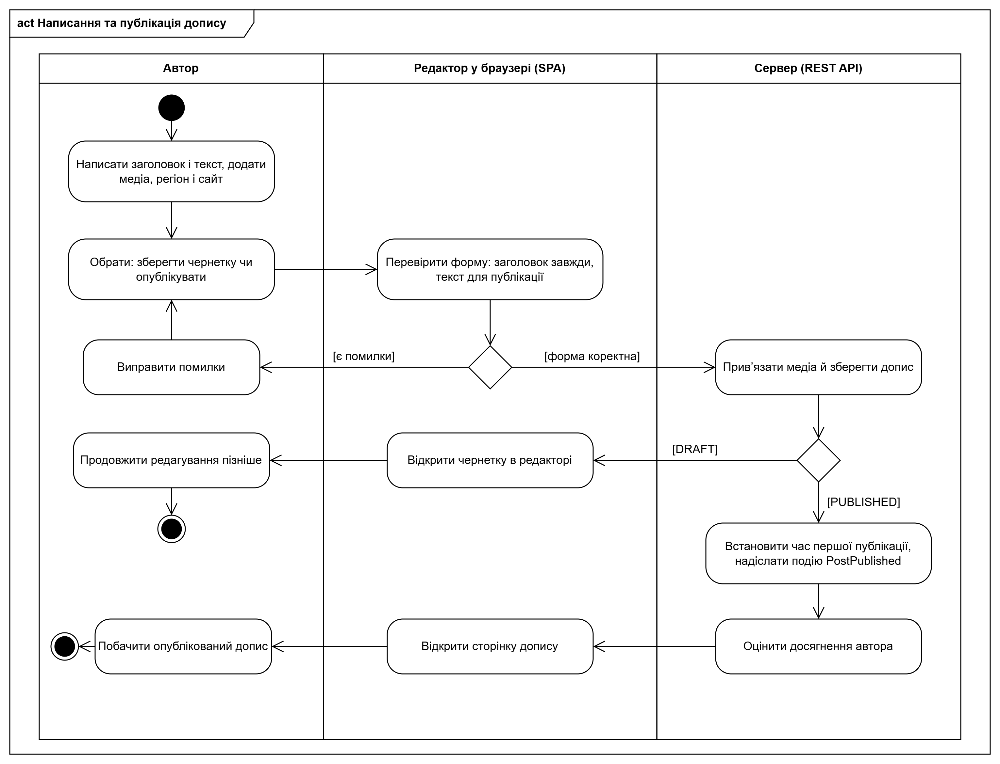

*Рисунок 4.4 — Написання та публікація допису*

Автор пише текст, додає медіа, регіон і сайт, а потім обирає, зберегти чернетку чи опублікувати. Редактор у браузері перевіряє форму: заголовок потрібен завжди, а текст лише для публікації. Сервер прив'язує медіа й зберігає допис, після чого шляхи розходяться. Чернетка знову відкривається в редакторі, а публікація фіксує час, надсилає подію `PostPublished`, оцінює досягнення автора й відкриває готову сторінку допису.

## 5. Діаграми взаємодії: діаграми послідовності

Діаграми послідовності належать до сімейства діаграм взаємодії. Вони показують, якими повідомленнями й у якому порядку обмінюються об'єкти під час одного сценарію. На рисунках використано справжні імена класів і методів із коду.

### 5.1. Вхід у систему

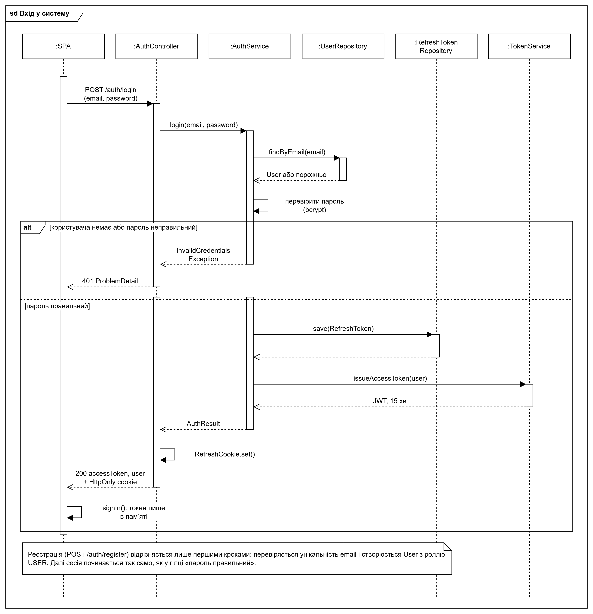

*Рисунок 5.1 — Вхід у систему*

SPA надсилає email і пароль, а `AuthService` знаходить користувача й перевіряє пароль через bcrypt. Помилка однакова для неіснуючого email і неправильного пароля, тож за відповіддю не можна дізнатися, хто зареєстрований. За правильного пароля створюється токен оновлення та JWT на 15 хвилин. Токен оновлення повертається в HttpOnly cookie, недоступному для JavaScript, а access-токен застосунок тримає лише в пам'яті.

### 5.2. Тихе оновлення сесії

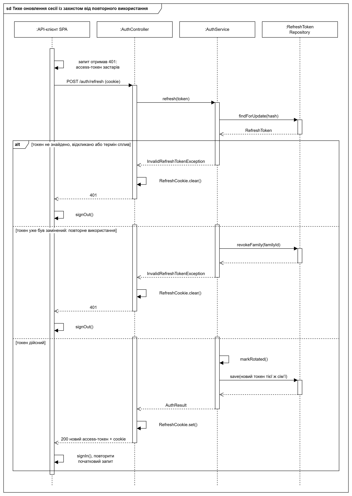

*Рисунок 5.2 — Тихе оновлення сесії із захистом від повторного використання*

Коли запит отримує відповідь 401, API-клієнт непомітно для користувача звертається по новий токен. `AuthService` читає запис із блокуванням рядка, тож два одночасні оновлення не обробляться двічі, і далі можливі три гілки. Недійсний токен завершує сесію. Повторно використаний токен спричиняє відкликання всієї сім'ї. Дійсний токен замінюється новим, після чого початковий запит автоматично повторюється.

### 5.3. Завантаження зображення

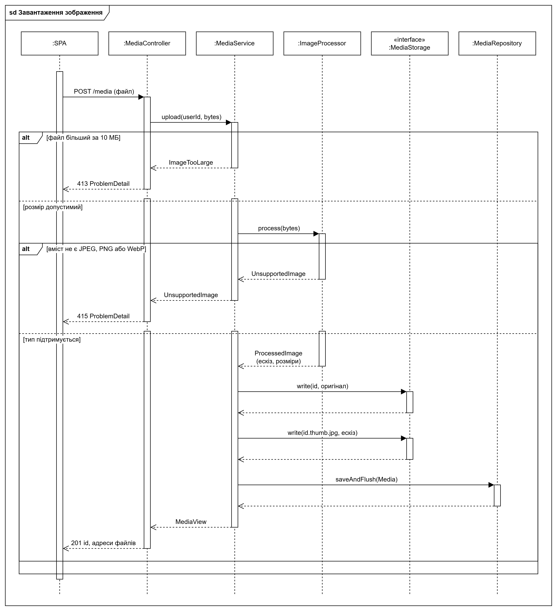

*Рисунок 5.3 — Завантаження зображення*

`MediaService` спочатку відсікає файли, більші за 10 МБ, а `ImageProcessor` визначає тип за вмістом файлу, а не за його назвою, і приймає лише JPEG, PNG та WebP. Для коректного файлу створюється ескіз, після чого оригінал і ескіз записуються через інтерфейс `MediaStorage`, а опис файлу — у базу. Клієнт отримує ідентифікатор і пізніше передає його разом із відгуком чи дописом.

### 5.4. Написання відгуку та оновлення рейтингу

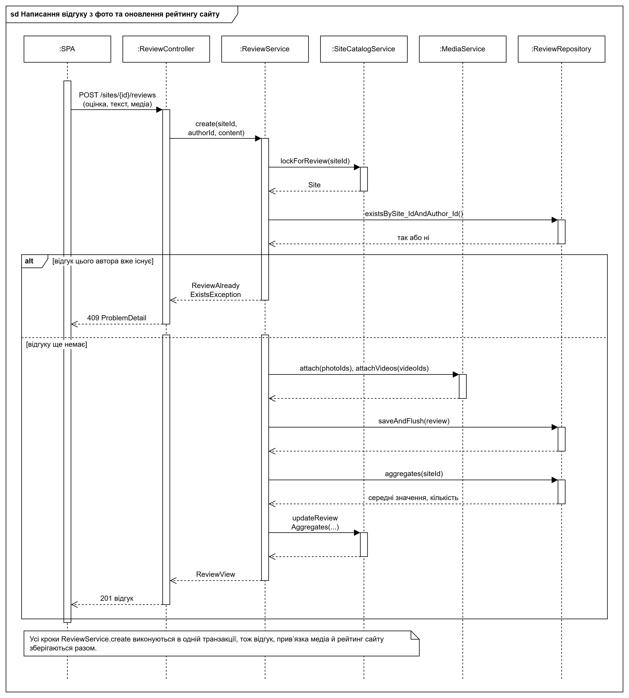

*Рисунок 5.4 — Написання відгуку з фото та оновлення рейтингу сайту*

`ReviewService` спочатку блокує сайт, щоб одночасні відгуки не зіпсували його рейтинг, і перевіряє, чи цей автор ще не залишав відгуку. Другий відгук від одного автора відхиляється відповіддю 409. Інакше медіа прив'язуються, відгук зберігається, а середні значення перераховуються й записуються в сайт. Усе це одна транзакція, тому відгук, файли й рейтинг змінюються разом.

### 5.5. Запис занурення та нарахування досягнень

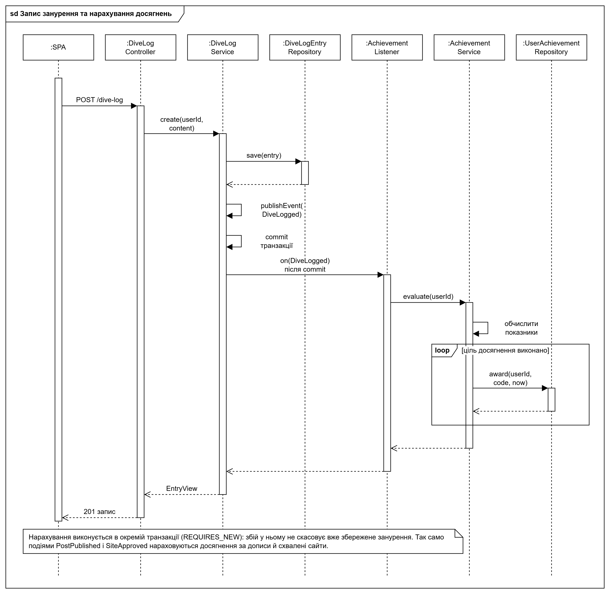

*Рисунок 5.5 — Запис занурення та нарахування досягнень*

`DiveLogService` зберігає запис і публікує подію `DiveLogged`, нічого не знаючи про те, хто її обробить. Після підтвердження транзакції `AchievementListener` запускає оцінювання, а `AchievementService` підраховує показники й у циклі нараховує кожне досягнення, ціль якого виконано. Нарахування має окрему транзакцію, тому збій у ньому не скасовує збереженого занурення. Так само працюють події `PostPublished` і `SiteApproved`.

## 6. Діаграми класів

Діаграми класів показують структуру даних і зв'язки між ними. Модель розбито за предметними сферами. Прямокутники лише з назвою (`User`, `Site`, `Region`) — це класи, докладно описані на іншому рисунку: їх повторено, щоб лінії не перетиналися.

### 6.1. Каталог дайв-сайтів і географія

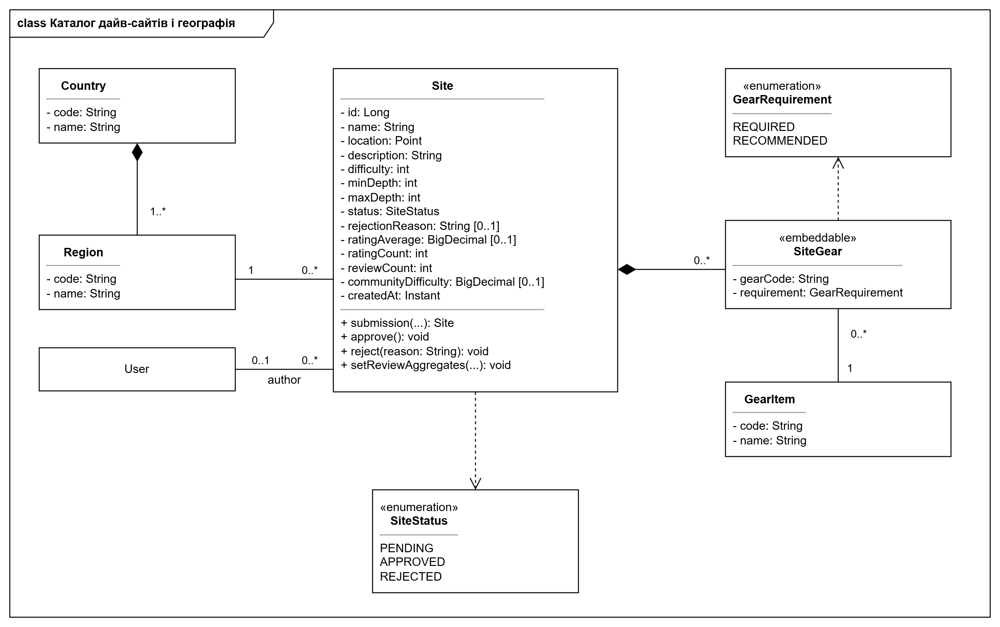

*Рисунок 6.1 — Каталог дайв-сайтів і географія*

У центрі стоїть `Site` із координатами, глибинами, складністю, статусом модерації та вже обчисленими показниками рейтингу, завдяки яким мапа не перераховує їх при кожному запиті. Кожен сайт належить одному регіону, регіони складають країну, а автор є необов'язковим, бо не всі сайти подані користувачами. Вимоги до спорядження описує вбудований клас `SiteGear`, який зв'язує сайт із довідником `GearItem` і вказує, обов'язковий це предмет чи рекомендований.

### 6.2. Контент спільноти та медіафайли

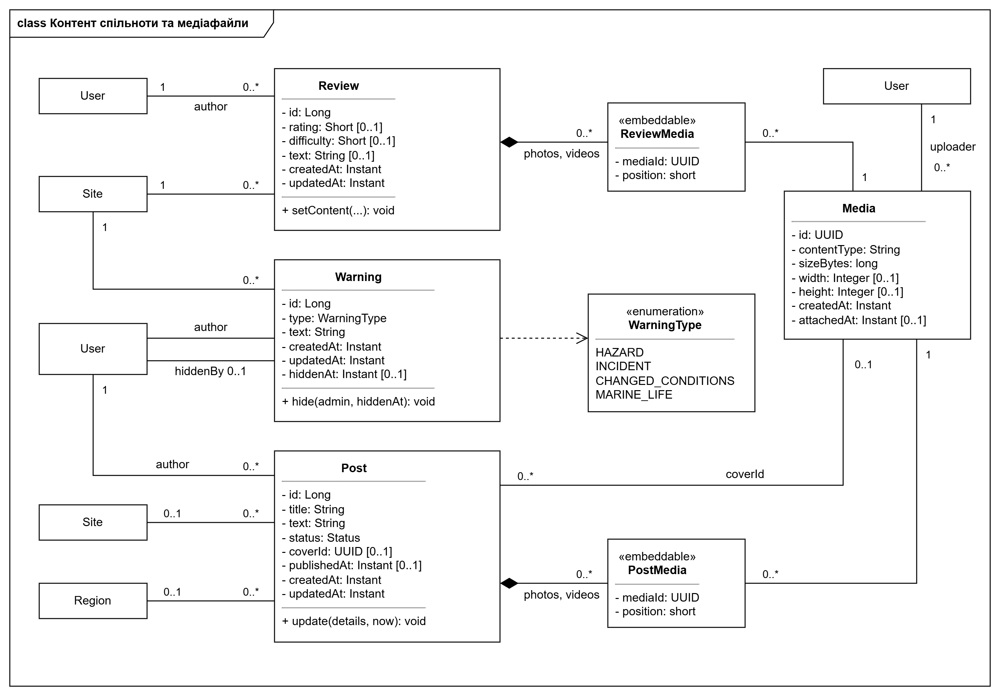

*Рисунок 6.2 — Контент спільноти та медіафайли*

Три види контенту мають автора, але по-різному пов'язані з місцем. `Review` і `Warning` завжди належать сайту, а `Post` може стосуватися сайту чи регіону, але не зобов'язаний. `Warning` окремо запам'ятовує адміністратора, який його приховав. Файли відгуків і дописів описують вбудовані класи `ReviewMedia` і `PostMedia`, які зберігають ще й порядок показу. Сам `Media` знає завантажувача й час прив'язки, від якого залежить його очищення.

### 6.3. Обліковий запис і діяльність дайвера

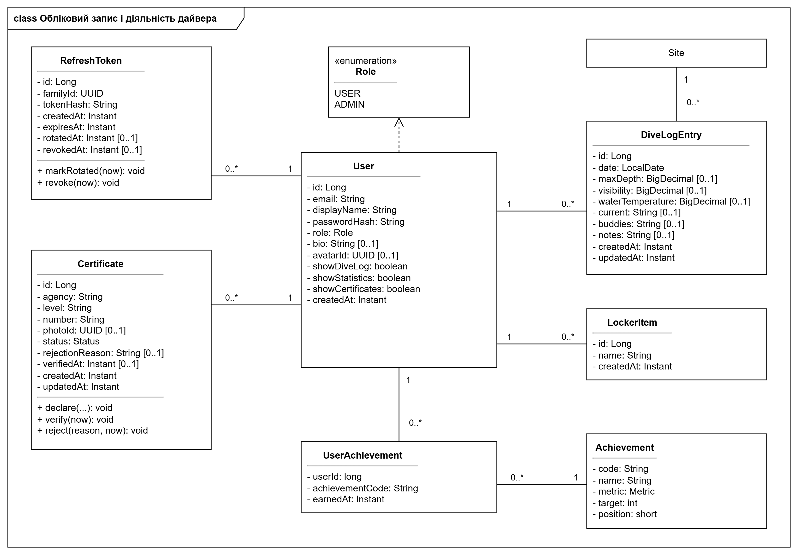

*Рисунок 6.3 — Обліковий запис і діяльність дайвера*

Усе тут зібрано навколо `User`, де разом із роллю зберігаються налаштування приватності. Ліворуч показано безпеку та підтвердження кваліфікації: токени оновлення й сертифікати. Праворуч показано особисту діяльність: записи журналу, кожен про конкретний сайт, і предмети шафки спорядження. Клас `UserAchievement` з'єднує користувача з довідником `Achievement` і зберігає час отримання, тому кожне досягнення лишається окремим фактом.

### 6.4. Шари back-end на прикладі відгуків

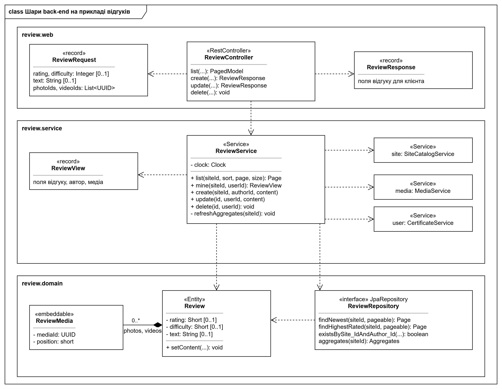

*Рисунок 6.4 — Шари back-end на прикладі відгуків*

Цей рисунок показує не дані, а будову коду, і кожен модуль організовано так само. Шар `web` приймає `ReviewRequest` і повертає `ReviewResponse` через контролер. Шар `service` містить правила й транзакції та звертається до інших модулів лише через їхні сервіси: каталогу сайтів, медіа та сертифікатів. Шар `domain` містить сутність і репозиторій. Усі залежності спрямовані згори вниз, а внутрішні сутності не потрапляють у відповіді API, бо між шарами передається `ReviewView`.

## 7. Діаграми компонентів

Діаграми компонентів показують, із яких замінних частин складається система і які інтерфейси ті надають одна одній. Рисунки йдуть від загального до деталей.

### 7.1. Складові системи DiveNet

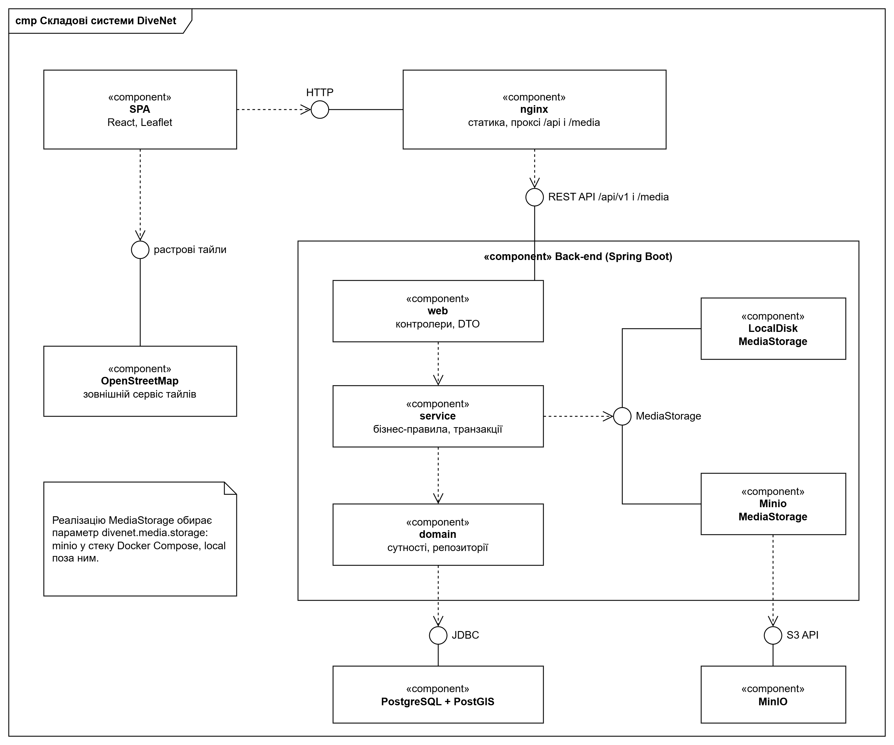

*Рисунок 7.1 — Складові системи DiveNet*

SPA отримує тайли мапи від OpenStreetMap, а все інше — через nginx, який проксіює REST API до back-end. Усередині back-end запит проходить компоненти `web`, `service` і `domain`, а останній працює з PostgreSQL через JDBC. Найцікавіше місце — інтерфейс `MediaStorage`: `service` залежить тільки від нього, а реалізацій дві, диск або MinIO. Параметр `divenet.media.storage` обирає потрібну без зміни бізнес-логіки.

### 7.2. Модулі back-end та їхні залежності

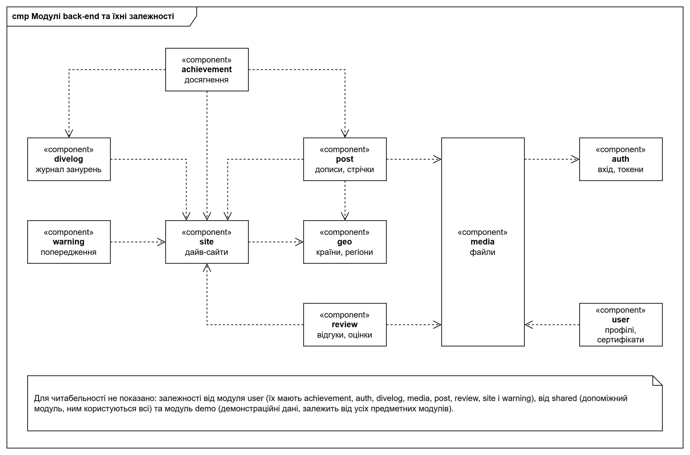

*Рисунок 7.2 — Модулі back-end та їхні залежності*

Back-end поділено на предметні модулі, і стрілки показують, хто кого використовує. Угорі стоїть `achievement`, який реагує на події журналу, дописів і сайтів, а модуль `site` є опорою для всього контенту. Файлами користуються `post`, `review` і `user`, але всі вони проходять через один модуль `media`. Щоб рисунок лишився читабельним, примітка перелічує залежності, які не намальовано: від `user`, `shared` і `demo`.

### 7.3. Структура застосунку в браузері

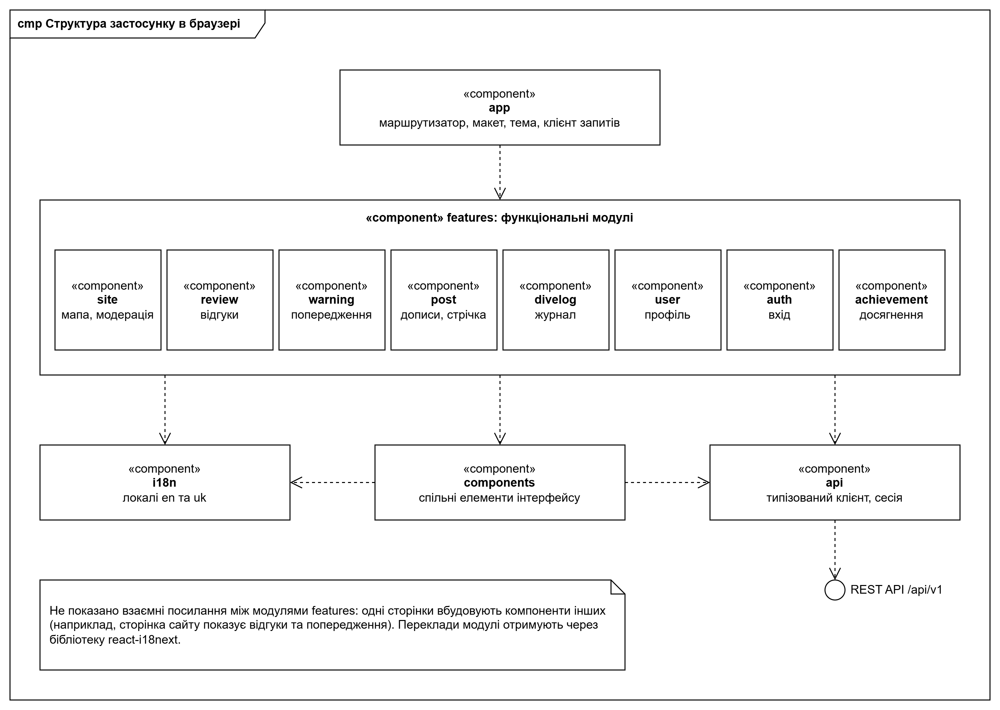

*Рисунок 7.3 — Структура застосунку в браузері*

Компонент `app` запускає застосунок: маршрутизатор, макет, тему та клієнт запитів. Він підключає функціональні модулі `features`, які майже повторюють модулі back-end. Усі вони спираються на три спільні частини: `i18n` із перекладами англійською та українською, `components` зі спільними елементами інтерфейсу та `api` із типізованим клієнтом. Лише `api` звертається до REST API, тому мережевий обмін і робота із сесією зосереджені в одному місці.

## 8. Використані програмні засоби

Діаграми побудовано у форматі draw.io (diagrams.net) і переглянуто у веборедакторі та переглядачі draw.io у браузері, без встановлення настільної програми. Вихідні файли `.drawio` створено власними скриптами на Node.js (`docs/uml/src`), які також перевіряють, що лінії не перетинаються. Зображення PNG експортовано зі сторінки перегляду в браузері. Вихідні файли лежать у каталозі `docs/uml`, тому кожну діаграму можна відкрити й змінити в draw.io.
